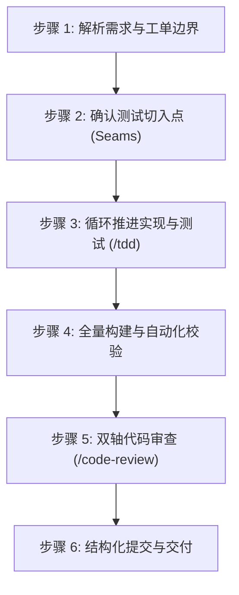

# 任务实施与代码落地指南 (Implement)

本技能指导 Agent 根据给定的需求规格说明书（Spec）、任务工单（Tickets）或当前会话中的技术设计，系统化、高质量地推进功能实现、测试验证与交付。

---

## 核心执行流程

---

## 执行步骤详解

### 步骤 1：解析需求与工单边界

1. **阅读输入源**：仔细研读用户提供的规格说明（Spec 路径、Issue 链接或工单描述）。若工单之间存在依赖关系（Blocked by），理顺执行拓扑，优先从无依赖阻塞的工单（Frontier）开始。
2. **对齐领域模型与设计约束**：
   - 检查项目中既有的架构决策记录（ADR）与领域通用语言（Ubiquitous Language）。
   - 明确本次实现的范围界限，严禁范围蔓延（Scope Creep）与无依据的过度设计。

### 步骤 2：确认测试切入点 (Seams)

1. 在动手编写代码前，识别公共调用接口与外部可观测行为，明确测试切入点（Seam）。
2. 遵循“最高有效切入点”原则：尽量在公开服务边界或 API 层进行验证，避免测试与私有实现细节紧密耦合。
3. 若存在架构分歧，与用户简短确认切入点符合预期。

### 步骤 3：循环推进实现与测试 (结合 `/tdd`)

1. **垂直切片推进**：每轮循环只处理一个可独立验证的垂直切片（Tracer Bullet），贯穿数据、业务逻辑与接口层。
2. **红绿重构循环**：
   - **红 (Red)**：先在切入点编写失败的测试用例。
   - **绿 (Green)**：编写仅能满足该测试通过的最少生产代码。
   - **重构 (Refactor)**：消除坏味道，优化结构，确保测试始终保持绿灯。
3. **渐进式验证**：
   - 编写过程中高频运行单个关联测试文件或受影响模块。
   - 保持终端与编译无报警、无错误。

### 步骤 4：全量构建与自动化校验

当工单功能全部编写完成后，执行项目完整的质量校验套件：
1. **类型检查 / 编译检查**：确保所有依赖、类型系统与接口契约 100% 通过（例如 `dotnet build`、`tsc --noEmit`、`cargo check` 等）。
2. **全量测试套件**：运行项目的全部单元测试与集成测试，确保无回归破损。
3. **格式化与代码风格**：运行 linter / formatter 工具，确保代码风格统一。

### 步骤 5：双轴代码审查 (结合 `/code-review`)

1. 在提交前，运行 `/code-review` 对本次修改的变更集进行全面体检：
   - **规范轴**：检查是否引入代码坏味道（如神秘命名、重复逻辑、依恋情结等），是否符合项目编码规范。
   - **需求轴**：对照原始 Spec / Tickets，核查是否存在遗漏的功能点或未经允许的冗余代码。
2. 根据审查结果进行针对性微调与修复。

### 步骤 6：结构化提交与交付

1. 使用 `git status` 与 `git diff` 确认暂存区干净、无遗漏调试文件或临时文件。
2. 可结合 `/commit-message` 技能，站在业务与功能价值视角生成符合规范的 Git 提交信息（Emoji + Karma 规范）。
3. 向用户汇报本次任务交付情况，列出关键修改文件与验证结果。
