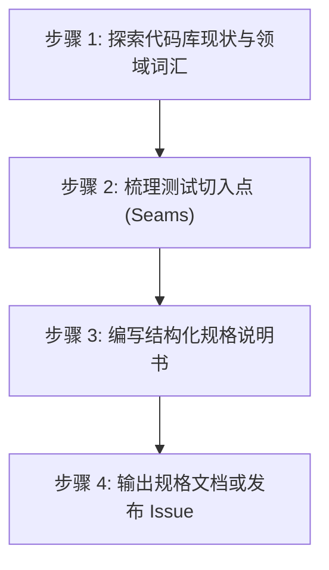

# 需求规格说明书编制指南 (To Spec)

本技能用于将当前会话的讨论上下文、架构设计及对代码库的探索认知，直接综合提炼为一份详尽、结构严谨的**需求规格说明书（Spec）**。

> [!IMPORTANT]
> **无需冗长访谈，直接提炼综合**  
> 本技能的核心原则是**不再重复盘问用户**，而是基于当前已有认知、技术推演与代码探索，直接归纳整理出完整规格。

---

## 执行步骤详解



### 步骤 1：探索代码库现状与领域通用语言

1. 若尚未充分探索代码库，先快速浏览关联模块，了解系统现状。
2. 规范术语：全篇 Spec 应严格遵循项目约定领域词汇（Domain Glossary），并尊重相关架构决策记录（ADR）。

### 步骤 2：梳理并确认测试切入点 (Seams)

1. 规划用于验证该特性的测试切入点（Seam）。
2. **切入点原则**：
   - 优先复用既有切入点，而非臆造新的切入点。
   - 尽可能使用最高级别的切入点（如公共业务 API、领域服务外观）。
   - 切入点越少越内聚，最理想的状态是单一核心切入点。
3. 若切入点涉及架构调整，向用户进行简要说明与确认。

### 步骤 3：编写规格说明书 (遵循标准模板)

按照下述模板撰写规格说明书，确保详实全面：

```markdown
# 需求规格说明书：[特性名称]

## 1. 问题陈述 (Problem Statement)
从用户/玩家的角度清晰描述当前面临的痛点或缺陷，解释为什么需要这项特性。

## 2. 解决方案概述 (Solution)
从用户/调用方的角度简述方案如何解决上述问题，带来何种直观改善。

## 3. 用户故事清单 (User Stories)
详尽列出该特性的用户故事清单，格式统一为：
- 作为 [角色]，我希望 [功能]，以便于 [业务价值/收益]。

示例：
1. 作为一名联机玩家，我希望在地图上看到同伴的头像带有专属边框，以便于快速区分彼此的角色状态。
2. 作为一名联机玩家，我希望在队友阵亡时弹出复活确认界面，以便于消耗资源救助队友。

> 注意：用户故事清单应尽可能穷尽所有使用场景与边界交互。

## 4. 实现架构决策 (Implementation Decisions)
列出本次实现达成的关键技术决策：
- 待新建或修改的核心模块与组件职责
- 各模块间公开接口（API / Contracts）的设计
- 关键状态流转（状态机、数据流）
- 边界与异常处理策略

> [!TIP]
> 除非代码片段本身比文字更精准（如状态机转移表、数据结构定义），否则尽量避免在 Spec 中堆砌特定具体私有文件路径或大段实现代码，以防文档随代码演进迅速过时。

## 5. 测试策略决策 (Testing Decisions)
- **测试标准**：明确测试只验证外部可观测行为，坚决不耦合内部私有细节。
- **切入点定义**：明确测试执行的最高 Seam 边界。
- **关联参考**：列出代码库中既有的优秀参考测试用例。

## 6. 范围外事项 (Out of Scope)
明确列出本次 Spec **坚决不涉及**的内容，避免范围蔓延。

## 7. 补充说明 (Further Notes)
任何额外的注意事项、已知风险或遗留讨论。
```

### 步骤 4：输出规格文档或发布 Issue

根据项目配置或用户偏好发布文档：
- **本地归档**：将文档写入 `.scratch/<feature-slug>/spec.md` 或 `docs/specs/<feature-slug>.md`。
- **远程 Issue**：发布到项目 Issue 跟踪系统（如 GitHub Issues），标记 `ready-for-agent` 或 `spec` 标签。
