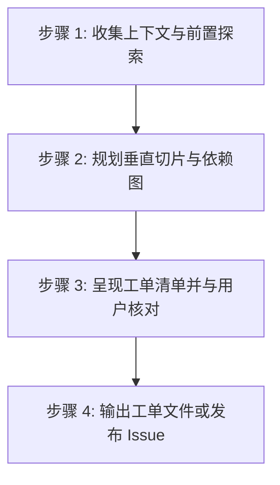

# 任务工单拆解指南 (To Tickets)

本技能用于将宏观的实施方案、需求规格说明书（Spec）或当前会话讨论，拆解为一组具备明确阻塞依赖关系（Blocking edges）的**垂直切片曳光弹工单（Tickets）**。

---

## 核心拆解法则

### 1. 垂直切片与曳光弹 (Vertical Slices & Tracer Bullets)
- **垂直贯通，拒绝水平切片**：每个工单应当窄而完整地纵向切通系统各层（数据结构、业务逻辑、UI 渲染、自动化测试），而不是横向切出一整层（如“只建所有模型”、“只写所有 UI”）。
- **独立可验证**：每个完成的工单都应当是能够独立运行、演示或通过测试进行验证的。
- **上下文窗口适配**：每个工单的体量应适配在单个独立的会话上下文窗口（Context Window）中完成。
- **前置重构先行 (Prefactoring)**：“先让改变变得容易，再做出容易的改变。”如果当前代码结构不利于扩展，先拆分一个前置重构工单。

### 2. 大范围重构的“扩展-收缩”法则 (Expand-Contract)
> [!TIP]
> **大范围重构是垂直切片的例外**  
> 当一项改动（如修改全局方法签名、重构核心基础结构）波及面极广（Blast Radius 巨大），无法在一个垂直切片中保持编译绿灯时，严禁生搬硬套。应采用**扩展-收缩 (Expand-Contract)** 策略：
> 1. **扩展 (Expand)**：先在旧结构旁新增新形式，新旧并存，不破坏现有任何调用点（工单 1）。
> 2. **迁移 (Migrate)**：按包/模块分批迁移调用点，每批次作为独立工单，由于旧形式仍保留，批次间持续保持 CI 绿灯（工单 2..N）。
> 3. **收缩 (Contract)**：当所有调用方迁移完毕后，在最后的工单中彻底删除旧形式（最终工单）。

---

## 执行步骤详解



### 步骤 1：收集上下文与前置探索
1. 研读当前会话的 Spec、方案文档或用户指令。
2. 快速探索相关代码库现状，寻找可提前实施的轻量前置重构（Prefactoring）契机。

### 步骤 2：规划工单切片与阻塞依赖 (Blocking Edges)
1. 为每个工单标注其**前置阻塞工单 (Blocked by)**。没有前置依赖的工单可以直接开始（处于 Frontier 前沿）。
2. 理顺工单执行序列，形成有向无环图（DAG）。

### 步骤 3：向用户呈现并确认工单拆解
以清晰的编号列表向用户展示工单规划：
- **工单标题**：简短明确的业务名称。
- **前置阻塞 (Blocked by)**：必须先完成哪些工单（若无则标“无，可立即执行”）。
- **交付价值**：该工单最终实现并使之运转的端到端行为。

主动征询用户反馈：
- 颗粒度是否合理？（过粗还是过细）
- 依赖阻塞链是否准确？（是否存在不必要的强耦合）
- 是否有需要合并或进一步拆分的工单？

### 步骤 4：输出工单文件或发布至跟踪器
待用户确认后，根据项目环境输出工单：

#### 选项 A：本地工单文件
在 `.scratch/<feature-slug>/issues/` 目录下按依赖顺序生成独立文件（`01-<slug>.md`, `02-<slug>.md` ...），每个工单一个文件：

```markdown
# 01 — [工单标题]

**实现目标：** 从用户/调用者角度描述该工单带来的端到端行为（而非死板的底层代码修改清单）。

**前置依赖 (Blocked by)：** 依赖的前置工单编号/标题，或“无 — 可立即执行”。

**状态：** 待认领 (ready-for-agent)

### 验收标准 (Acceptance Criteria)
- [ ] 验收条件 1
- [ ] 验收条件 2
```

#### 选项 B：项目 Issue 跟踪平台 (GitHub Issues 等)
按拓扑顺序在平台创建 Issue，设置父子关系或在正文中引用依赖 Issue 编号，并打上 `ready-for-agent` 标签。
