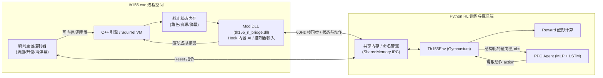

# Repository Guidelines

## 项目概述

面向 **《东方凭依华》（Touhou 15.5 — Antinomy of Common Flowers，東方憑依華 / *th155*，v1.21b）** 的强化学习 AI 框架。这是一个 2v2 换人制（完全凭依）2D 格斗游戏。

项目的核心目标是：**直接从单机游戏内部获取结构化状态数据，通过 Mod / DLL 注入接管并替换游戏的内置 AI，训练一个能根据实时战况做出反应、并与人类玩家流畅对战的强化学习 AI。**

详细的 RL 任务规格、内部状态特征设计、动作空间、奖励函数与实施计划详见 [`docs/rl_task.md`](docs/rl_task.md)。本文件是给 AI 助手使用的代码库指南。

- **参考游戏安装目录**：`D:/[th15.5] 东方凭依华（英文版+日文版）/` — 包含 `th155.exe`（主程序，v1.21b）、`th155_log.exe`（带调试日志输出）、`th155.pak`/`th155b.pak`（含 Squirrel `.nut` 脚本与资产数据）、`score.dat`（存档）。
- **状态**：greenfield（全新项目），代码尚未编写；下文目录是计划中的脚手架。在读取前不要假设文件已存在。
- **核心技术路线**：
  1. **内部状态直读（State Extraction）**：不做低效的纯屏幕图像识别，而是通过逆向 `th155.exe`（配合 IDA Pro MCP 分析 C++ 引擎与内嵌 Squirrel VM）及注入 Mod DLL，直接读取双方角色精确状态（坐标、速度、动作 ID、帧数、HP/白血、灵力、怪奇槽、符卡槽及场上弹幕实体）。
  2. **内置 AI 替换（AI Hook / Mod Injection）**：游戏本身具备内置 COM AI。通过 Hook 内置 AI 的决策更新函数（或直接覆写内部虚拟输入结构体），在训练时控制受训角色对抗不同难度的内置 COM，在实战时直接替换 COM 逻辑与人类玩家对战（无需抢占系统键盘焦点）。
  3. **内存/脚本级瞬间重置（Instant Reset）**：在战斗场景内通过内存写入或调用内部重置函数，将双方血量、坐标、资源与计时器瞬间归位，跳过繁琐的菜单导航，大幅提升训练采样效率。
  4. **单角色组合先行**：第一阶段固定 **博丽灵梦（Master）+ 雾雨魔理沙（Slave）** 打通全链路，通过课程学习（打内置 COM 1 → COM 5）完成训练，再与人类玩家实战。

## 架构与数据流

- **双模式运行**：
  - **训练模式（Training Mode）**：`Th155Env` 通过共享内存（Shared Memory + Win32 Event 帧同步锁）与注入到 `th155.exe` 的 `th155_rl_bridge.dll` 通信。受控方（由 RL 控制）与对手方（游戏原生 COM 难度 1–5）在战斗场景内循环对战，回合结束时触发内存级瞬间重置。
  - **人机对战模式（Player vs AI Mode）**：人类玩家正常操作 1P，Mod DLL 拦截 2P（COM）的 AI 输入更新，将实时状态发给推理进程（或由 DLL 内嵌 ONNX Runtime 直接推理），把模型输出的动作注入 2P 输入结构体，实现零延迟、免焦点的原生级 AI 对战体验。

## 关键目录（计划）

| 路径 | 用途 |
|---|---|
| `src/bridge/` | 游戏桥接层：C++ Mod DLL 源码（`dllmain.cpp`、`hook_ai.cpp`、`state_reader.cpp`、`state_reset.cpp`）及 Python 侧共享内存客户端 `shm_client.py` |
| `src/env/` | Gymnasium 环境：`th155_env.py`、`obs_builder.py`（结构化状态归一化与特征工程）、`action_space.py`（动作掩码与虚拟按键映射）、`reward.py`、`proc.py`（进程启动与 DLL 注入） |
| `src/agents/` | 策略网络：`ppo_agent.py`（处理玩家状态 + 弹幕集合的 Attention/PointNet + MLP + LSTM 架构）、`random_agent.py` |
| `src/train/` | `train_ppo.py`、课程调度器 `curriculum.py`（COM 1 → 5 自动晋级）、`eval.py`、模型导出 `export_onnx.py` |
| `src/play/` | `vs_human.py` — 挂载到运行中的游戏，接管内置 AI 与人类玩家实时对战 |
| `configs/` | `offsets.yaml`（逆向出的内存偏移与结构体定义）、`env.yaml`、`train_ppo.yaml` |
| `scripts/` | 逆向与冒烟脚本：`inject_dll.py`、`dump_state_test.py`、`override_ai_test.py`、`instant_reset_test.py` |
| `tests/` | 单元测试（Mock 共享内存测试环境逻辑、特征归一化、动作映射、奖励计算） |
| `docs/` | `rl_task.md` — 详细的 RL 任务与工程实施计划文档 |

## 开发命令（计划）

| 任务 | 命令 |
|---|---|
| 安装 Python 依赖 | `pip install -r requirements.txt`（gymnasium, torch, numpy, pywin32, PyYAML, tensorboard, onnx, onnxruntime） |
| 编译 Bridge DLL | `cmake -B build/bridge -A Win32 && cmake --build build/bridge --config Release`（注意 `th155.exe` 为 32 位 x86 程序，DLL 必须编译为 `Win32/x86`） |
| 冒烟：注入与状态读取 | `python scripts/dump_state_test.py`（实时打印双方坐标、HP、动作 ID 与弹幕数量） |
| 冒烟：接管内置 AI | `python scripts/override_ai_test.py`（注入指令控制 COM 角色移动与出招） |
| 冒烟：瞬间重置 | `python scripts/instant_reset_test.py`（验证回合内一键满血归位重开） |
| 训练 | `python -m src.train.train_ppo --config configs/train_ppo.yaml` |
| 评估（打内置 COM） | `python -m src.train.eval --ckpt <path> --com-level 5 --matches 50` |
| 人机实战挂载 | `python -m src.play.vs_human --ckpt <path>` |
| 单元测试 | `pytest tests/ -v`（无需启动游戏进程） |
| Lint | `ruff check src tests` + `ruff format --check .` |

## 代码规范与常见模式

- **位数匹配（关键约束）**：`th155.exe` 是 **32 位（x86 PE）** 程序。所有注入游戏的 DLL 必须编译为 32 位（`Win32`），共享内存结构体必须使用 `#pragma pack(push, 1)` 固定字节对齐并显式使用定长整数类型（`int32_t`, `uint32_t`, `float`），严禁在 IPC 结构体中使用裸指针或 `size_t`。
- **Python 3.11+**，PEP 8，`ruff` 负责 lint/format（行长 100）。
- **环境接口**：继承 `gymnasium.Env`；
  - `observation_space` 为结构化浮点向量 `Box(-np.inf, np.inf, (OBS_DIM,), np.float32)`（或 `Dict` 包含 `self_state`、`opp_state`、`projectiles`）；
  - `action_space` 为 `Discrete(N)`，同时通过 `info["action_mask"]` 提供**动作掩码（Invalid Action Masking）**（例如灵力不足、怪奇槽未满或冷却中时屏蔽对应动作）。
- **步进与帧同步**：`env.step(action)` 通过共享内存写入虚拟按键位掩码（`uint16_t input_mask`），通知游戏推进 `action_repeat`（默认 4 帧，约 66.7ms，每秒 15 次决策）帧后读取最新状态快照。
- **不依赖前台焦点**：所有控制均通过内部输入结构体/AI 函数 Hook 完成，支持后台静默运行、最小化运行或多开并行训练。
- **配置管理**：所有内存基址/偏移放 `configs/offsets.yaml`，环境与奖励权重放 `configs/env.yaml`，训练超参放 `configs/train_ppo.yaml`；源码内不硬编码魔法数字。

## 重要文件

- `docs/rl_task.md` — 整体计划文档与 RL 核心契约（状态特征、动作编码、奖励函数、逆向与注入方案）。
- `configs/offsets.yaml` — `th155.exe` (v1.21b) 的关键基址、指针链与结构体偏移表。
- `src/bridge/` — C++ 注入模块与共享内存协议定义（`protocol.h`）。
- `src/env/th155_env.py` — Gymnasium 环境封装。
- `src/env/obs_builder.py` — 原始内存数据到神经网络归一化特征向量的转换器。
- `src/env/reward.py` — 基于精确内部状态（HP、白血、灵力、破防、距离等）的奖励塑形。

## 运行时/工具偏好

- **操作系统**：Windows（当前工作站 win32 10.0.26100）。
- **逆向工程工具**：优先使用工作区已配置的 **IDA Pro MCP** 分析 `th155.exe`，定位战斗管理器（Battle Manager）、角色对象（Actor/Player）、内置 AI 控制器（CPU Controller）和 Squirrel VM 函数表。
- **游戏版本**：固定面向 `th155.exe` **v1.21b**，初始化时校验 PE 时间戳或哈希，防止版本不一致导致偏移错位崩溃。

## 测试与 QA

- **单元测试（无头）**：使用 Mock 共享内存验证 `obs_builder.py`（特征边界、对称性/翻转归一化）、`action_space.py`（方向翻转与动作掩码）、`reward.py`（伤害、白血回复、胜负终局奖励）。
- **集成冒烟测试（需启动游戏）**：在进入 RL 训练前，必须依次通过 `dump_state_test.py` → `override_ai_test.py` → `instant_reset_test.py` 三个冒烟关卡。
- **评估纪律**：每个 COM 难度等级（1–5）评估 ≥ 50 个回合，记录胜率、平均剩余血量差、平均回合帧数。
