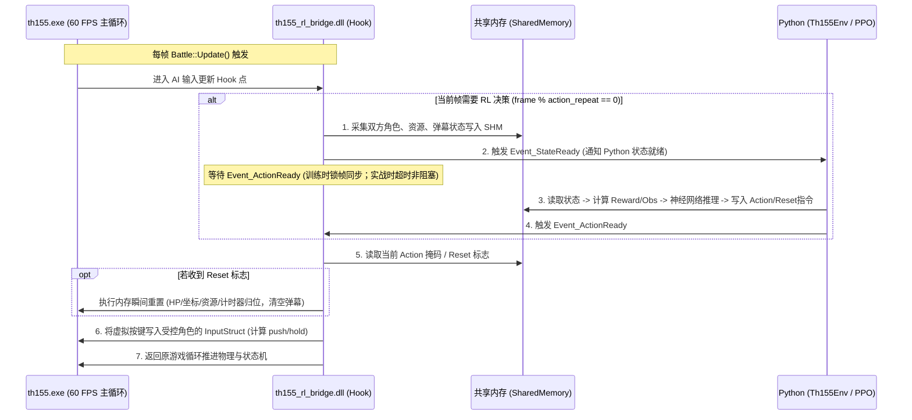
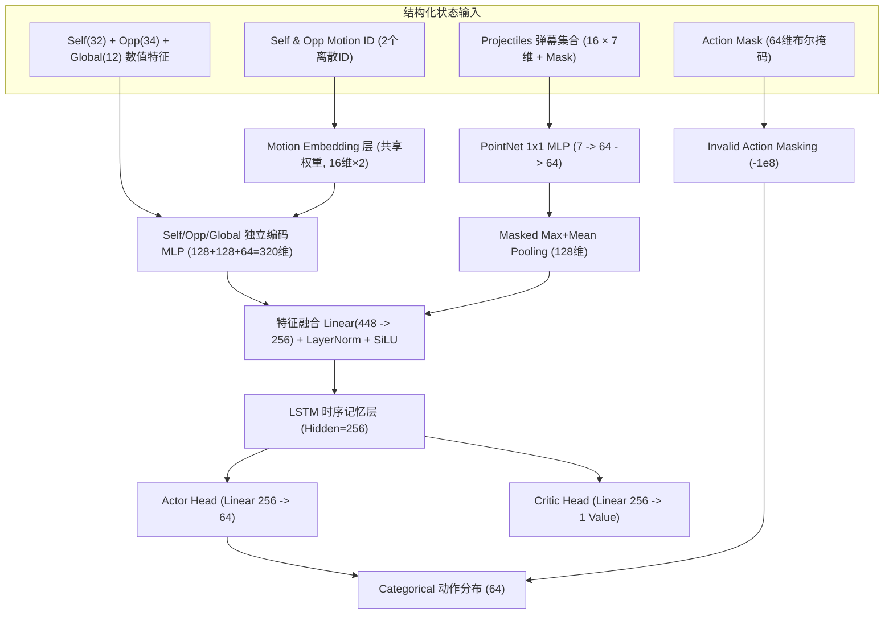

# RL 任务与工程实施计划：《东方凭依华》（th155）内置 AI 强化学习替换方案

状态：**架构与计划已重构（基于内部状态直读 + 内置 AI 替换 + 内存瞬间重置）**。配套代码库指南：[`AGENTS.md`](../AGENTS.md)。

---

## 1. 项目目标与核心思路

本项目的目标是针对单机格斗游戏 **《东方凭依华》（Touhou 15.5 — Antinomy of Common Flowers，v1.21b）**，开发一套**直接从游戏内部读取状态数据、并通过接管/替换游戏内置 AI 与人类玩家实时战斗**的强化学习系统。

### 1.1 核心设计决策

1. **直接获取内部结构化状态（告别截屏图像识别）**：
   - 作为本地单机游戏，直接通过进程内存读取 / Mod DLL 注入（`th155_rl_bridge.dll`）获取双方角色的精确数值状态（坐标、速度、动作 ID、动作帧、硬直、HP、白血、灵力、怪奇槽、符卡槽）以及场上所有弹幕/飞行道具的坐标与速度。
   - 相比像素级截屏（CNN），结构化状态输入维度小、信息无损（包含精确帧数与隐藏计量条）、推理延迟低于 **0.5ms**，训练样本效率提升一个数量级以上。
2. **接管/替换内置 AI（原生级人机对战体验）**：
   - 游戏原本内置了 CPU 对手（COM 难度 1–5）。我们通过 Hook 游戏内部 AI 控制器的每帧输入更新函数（或直接覆写虚拟输入结构体），将 RL 模型的决策结果注入为角色的虚拟按键。
   - **训练阶段**：RL Agent 控制一方（如 1P），与游戏原生内置 COM（2P，难度 1–5）对战。
   - **与玩家战斗阶段**：人类玩家正常使用键盘/手柄操作 1P，RL Agent 直接替换 2P 的内置 AI 逻辑与玩家对战，**无需抢占系统窗口焦点，也不与玩家键位冲突**。
3. **内存/脚本级回合瞬间重置（Instant State Reset）**：
   - 仅在游戏启动时进入一次战斗场景；每当一局分出胜负（或超时），通过写内存/调用游戏内部重置函数，在 **1 帧之内** 将双方血量、白血、灵力、怪奇槽、坐标和计时器归位并清空场上弹幕，跳过所有菜单导航与加载动画，实现无缝高速训练。
4. **角色与训练演进策略**：
   - **首发固定阵容**：第一阶段固定 **博丽灵梦（Master）+ 雾雨魔理沙（Slave）** 跑通数据提取、环境交互、课程训练与玩家实战，后续再扩展多角色特征嵌入。
   - **课程学习路径**：仅通过与内置不同难度 COM 对战进行课程式强化学习（站桩靶子 → COM 1 → COM 2 → COM 3 → COM 4 → COM 5），训练成熟后直接挂载与人类玩家对战。

### 1.2 里程碑与验收标准

| 里程碑 | 阶段目标 | 验收指标 |
|---|---|---|
| **M1：逆向与数据打通** | 完成 `th155.exe` 关键地址逆向与 Bridge DLL 注入 | 能以 60Hz 稳定读取双方坐标/HP/动作ID/弹幕，能覆写 AI 按键，能一键瞬间重置回合 |
| **M2：基础连段与立回（胜 COM 1）** | 训练 Agent 掌握接近、攻击、换人回血与基础防御 | 对战内置 COM 1（50 局评估）胜率 **≥ 85%** |
| **M3：中阶博弈（胜 COM 3）** | 学会轴移动躲弹幕、灵力管理、怪异必杀与连段衔接 | 对战内置 COM 3（50 局评估）胜率 **≥ 75%** |
| **M4：高阶压制（胜 COM 5）** | 掌握版边压制、结界脱离、拆投与符卡爆发 | 对战内置 COM 5（50 局评估）胜率 **≥ 70%** |
| **M5：人类玩家实战部署** | 封装 `vs_human.py`（或纯 DLL 内置 ONNX 推理 Mod） | 玩家打开游戏进入对战即可与 RL AI 流畅交手，单步推理耗时 **< 2ms**，帧率稳定 60 FPS |

---

## 2. 游戏引擎分析与底层交互架构

### 2.1 《东方凭依华》底层技术特征

- **可执行文件**：`D:/[th15.5] 东方凭依华（英文版+日文版）/th155.exe`（v1.21b，**32 位 x86** 应用程序）。
- **引擎架构**：黄昏边境（Twilight Frontier）自研 2D/3D 混合引擎，底层渲染、物理碰撞与输入轮询由 **C++** 实现，而角色状态机（Motion/State）、招式派生、内置 COM AI 逻辑以及回合管理由内嵌的 **Squirrel 虚拟机（`.nut` 脚本，打包于 `th155.pak` / `th155b.pak`）** 驱动。
- **游戏帧率与逻辑更新**：固定 **60 FPS** 帧同步逻辑更新。每帧调用一次战斗场景的 `Update()`，在其中依次轮询 1P/2P 输入（或调用 COM AI 脚本生成虚拟输入）、推进角色状态机、更新弹幕坐标并结算碰撞伤害。

### 2.2 注入与通信架构（Mod DLL + 共享内存）

为了兼顾 C++ 访问内部内存/虚表的高效性与 PyTorch 训练的灵活性，采用 **`th155_rl_bridge.dll`（32位 C++ 注入模块） + Win32 共享内存（Shared Memory） + 双命名事件（Event 帧同步）** 架构：



### 2.3 三大底层核心机制实现方案

1. **状态直读（State Reader）**：
   - 使用 **IDA Pro MCP** 静态分析 `th155.exe`（结合 `th155_log.exe` 的符号/日志字符串与 Squirrel 绑定函数名，如 `health`, `regain`, `sp`, `occult`, `spell`, `x`, `y`, `vx`, `vy`, `motion`, `keyFrame`, `direction`），定位全局战斗管理器指针链与角色结构体偏移，记录到 `configs/offsets.yaml`。
   - 同时支持从 C++ 结构体直接按偏移读取（最快，微秒级）或通过 Squirrel VM C API（`sq_get`）读取脚本表字段。
2. **内置 AI 替换（AI Controller Override）**：
   - 游戏中每个角色实例拥有一个控制器输入结构 `InputState`，包含方向轴（`axis_x`, `axis_y`）及各功能键的当前状态（`b0` 打撃、`b1` 射撃、`b2` 必殺、`b3` 凭依换人、`b4` 冲刺/结界）。
   - 游戏内置 AI 在每帧通过 `CPUController::Update()` 计算出按键并填入该结构。我们的 Hook 挂载在该更新函数末尾：当启用 RL 接管时，直接用 RL 输出的动作位掩码覆盖 `InputState`，并自动维护**刚按下边沿（`pressed_edge = current & ~prev`）**与**按住帧数计数（`hold_frames`）**，确保需要“单次触发”或“按住蓄力”的招式均能被游戏引擎正确识别。
3. **回合瞬间重置（Instant Reset）**：
   - 当检测到一方 Master 与 Slave 总血量归零（或将要归零进入 K.O. 慢动作前 1 帧），或达到最大回合帧数上限时：
     - Python 端完成本 Episode 的末步奖励结算；
     - 下发 `CMD_INSTANT_RESET` 标志；
     - Bridge DLL 直接将 1P 与 2P 的 Master/Slave HP 与白血恢复为最大值（或指定随机初始值以增强泛化），将灵力恢复至满格（1000），重置怪奇槽与符卡槽，将双方坐标重置到开局标准站位（`1P: x = -300, y = 0, dir = +1`；`2P: x = +300, y = 0, dir = -1`），强制将双方 `motion_id` 设为中立待机（Stand），清空场上弹幕链表，并将回合计时器重置为 `99`。

---

## 3. 强化学习环境设计（Gymnasium 接口）

### 3.1 视角归一化（左右镜像不变性）

格斗游戏中，角色位于对手左侧（1P 位）或右侧（2P 位）时的按键方向相反。为了使模型参数量减半、样本效率翻倍，并且**无论作为 1P 还是 2P 都能直接使用同一套策略**：

- 定义标准参考系方向因子 $s = \text{sign}(x_{\text{opp}} - x_{\text{self}}) \in \{-1, +1\}$（若重合则取自身当前面朝方向 `dir`）。
- 所有水平相对位置、水平速度均乘以 $s$：即 **“朝向对手为正（Forward），背离对手为负（Back）”**。
- 动作空间中的水平方向同样定义为 **前（Forward）** 与 **后（Back）**，在写入游戏内存前由环境根据 $s$ 动态还原为物理的 `Left` 或 `Right`。

### 3.2 结构化观测空间（Observation Space）

观测由四部分组成，使用 `gymnasium.spaces.Dict`（或在送入网络前展平拼接为 1D `float32` 向量），所有连续数值均按物理上限归一化到 $[-1.0, 1.0]$ 或 $[0.0, 1.0]$：

#### (1) 自身队伍特征 `self_team`（32 维）
| 字段 | 维度 | 说明与归一化方式 |
|---|---|---|
| `active_char_id` | 2 | 当前在场角色 One-hot：`[1, 0]` 为 Master（灵梦），`[0, 1]` 为 Slave（魔理沙）；在场角色的物理属性根据 `team.current` 动态选取 |
| `pos_x_center`, `pos_y` | 2 | 相对于场地中心的归一化坐标 $(s \cdot (x - 640) / 640, y / 360 - 1)$ |
| `dist_to_back_wall`, `dist_to_front_wall` | 2 | 距离身后版边、身前版边的归一化距离 $[0, 1]$（感知版边压制/被关厕所风险） |
| `vel_x_rel`, `vel_y` | 2 | 相对水平速度 $(s \cdot v_x / 20)$、垂直速度 $(v_y / 20)$ |
| `lane_axis` | 3 | 当前所处垂直轴线 One-hot（高轴 / 中轴 / 低轴） |
| `facing_opponent` | 1 | 当前角色面朝方向是否正对对手（`1.0` 正对，`-1.0` 背对/被绕背） |
| `motion_id` | 1 (Int) | 当前动作状态 ID（同时送入 `nn.Embedding(num_motions, 16)` 编码为 16 维向量） |
| `motion_frame_norm` | 1 | 当前动作已进行的帧数 $\min(\text{frame} / 60.0, 1.0)$ |
| `hitstop_stun_norm` | 2 | 剩余受击硬直 / 防御硬直帧数归一化 |
| `status_flags` | 6 | 二值标志：`[是否可行动(free), 是否攻击判定中, 是否防御中, 是否受击中, 是否倒地/不可受身, 是否无敌]` |
| `hp_master`, `regain_master` | 2 | Master 实血与白血上限比例 $[0, 1]$（除以 `MAX_HP`） |
| `hp_slave`, `regain_slave` | 2 | Slave 实血与白血上限比例 $[0, 1]$ |
| `sp_current`, `sp_max_balls` | 2 | 当前灵力值比例 $[0, 1]$、当前可用灵力格数比例（破防会扣上限） |
| `occult_gauge`, `tag_ready` | 2 | 怪奇槽进度 $[0, 1]$、当前是否允许完全凭依换人（布尔值） |
| `spell_gauge`, `spell_declared` | 2 | 符卡可用标志、是否已发动符卡 |

#### (2) 对手队伍特征 `opp_team`（34 维）
- 包含与 `self_team` 完全对称的 32 维字段（对手在场角色 ID、坐标、相对速度、轴线、动作 ID、动作帧、状态标志、实血与白血、灵力、怪奇槽、符卡槽）。
- 额外增加 2 维核心相对几何特征：
  - `rel_dx`：$|x_{\text{opp}} - x_{\text{self}}| / 1280.0 \in [0, 1]$（双方水平间距）；
  - `rel_dy`：$(y_{\text{opp}} - y_{\text{self}}) / 720.0 \in [-1, 1]$（双方垂直高度差）。

#### (3) 全局与历史特征 `global_context`（12 维）
- 回合剩余时间比例 $\text{timer} / 99.0 \in [0, 1]$；
- 双方总血量优势差 $(\text{HP}_{\text{self}} - \text{HP}_{\text{opp}}) / (2 \times \text{MAX\_HP}) \in [-1, 1]$；
- 回合序号、战斗状态标志及上一步 Agent 选择的动作（方向与按钮编码，帮助网络维持蓄力/连打连续性）。

#### (4) 场上弹幕/飞行道具特征 `projectiles`（固定槽位 $K = 16 \times 7$ 维 + Mask）
格斗东方最核心的特色是满屏弹幕立回。从内存弹幕链表中提取当前场上活跃的飞行道具，按距离 AI 在场角色由近到远排序，截取前 $K=16$ 个（不足补零并标记 `valid_mask = 0`）：
- 每个弹幕 7 维特征：
  1. `rel_x`：$s \cdot (x_{\text{proj}} - x_{\text{self}}) / 640.0$（正值表示在身前，负值在身后）
  2. `rel_y`：$(y_{\text{proj}} - y_{\text{self}}) / 360.0$
  3. `rel_vx`：$s \cdot v_{x,\text{proj}} / 20.0$（负值表示正在向自己飞来）
  4. `rel_vy`：$v_{y,\text{proj}} / 20.0$
  5. `radius_or_size`：判定框半径归一化
  6. `owner_flag`：`+1.0` 为己方发射的弹幕（可用于掩护进攻），`-1.0` 为敌方弹幕（需躲避/擦弹/防御）
  7. `can_graze`：是否可擦弹（冲刺穿过无伤）

---

### 3.3 动作空间与动作掩码（Action Space & Masking）

#### (1) 决策频率
- 支持 `action_repeat = 4`（15 Hz）或 `action_repeat = 2`（30 Hz，训练默认配置）。既能满足格斗游戏确认立回、受身与连段输入需求，又通过截断 BPTT 与高折扣因子保持长期信用分配。

#### (2) 相对方向 × 按键组合（共 64 个离散动作）
采用格斗游戏小键盘数字记号（以面朝对手为右 `6`，背离对手为左 `4`）：
- **9 个相对方向**：
  - `5`（中立）、`6`（前走）、`4`（后退 / 站立防御）、`8`（上轴移动）、`2`（下轴移动）
  - `9`（前上）、`7`（后上）、`3`（前下）、`1`（后下 / 下段防御）
- **7 种基础按键状态**：
  1. `None`（仅移动/防御/中立）
  2. `A`（打撃 `Z`：轻攻击 / 连段起手 / 近身 `6A` 投技与拆投）
  3. `B`（射撃 `X`：消耗灵力发射弹幕）
  4. `C`（必殺技 `C`：消耗灵力释放必杀技）
  5. `D`（冲刺/急升降/灵击结界 `S`：配合方向实现前冲擦弹、后撤、跨轴急升急降，防御中按 `4D` 触发灵击结界推开对手）
  6. `Tag`（完全凭依换人 `A键`：切换 Master/Slave、连段换人追击、受击换人脱离）
  7. `Occult`（怪异必杀技 `Z+X`）
- **高阶爆发独立动作**（绑定中立方向）：
  - `Spell`（符卡宣言 / 符卡发动 `X+C`）
- **总计动作数**：$9 \times 7 + 1 = 64$ 个离散动作（`Discrete(64)`）。

#### (3) 动态动作掩码（Invalid Action Masking）
由于我们直接读取内部状态，在每步返回 `obs` 时同步计算布尔掩码 `info["action_mask"]`（维度 `(64,)`），将当前必不可能生效或违背规则的动作 logits 置为 `-1e8`（softmax 概率精确为 `0.0`）：
- 当 `sp_current <= 0`（灵力耗尽）时，屏蔽所有 `B`（射撃）、`C`（必殺技）与 `Occult` 动作；
- 当 `tag_ready == False`（`slave_ban != 0` 或 `op < 1000`）时，屏蔽所有 `Tag`（换人）动作；
- 当 `op < 2000` 时，屏蔽 `Occult` 动作；
- 当 `spell_ready == False`（`op < 2000` 或 `sp < sp_max2`）时，屏蔽 `Spell` 动作。

---

### 3.4 奖励与惩罚函数设计（Reward & Penalty Shaping）

实现文件：[`src/env/reward.py`](../src/env/reward.py)，权重配置文件：[`configs/env.yaml`](../configs/env.yaml)。

利用内部精确状态，构建兼具**零和对抗性**、**立回技战术激励（打康/确反/连段）**、**凭依华双人换人机制引导**以及**严格势函数防刷分（Anti-Reward-Hacking）**的奖惩体系。每步总回报 $r_t$ 由 **7 个独立监控分项**求和组成：

$$r_t = r_{\text{hp}} + r_{\text{regain}} + r_{\text{resource}} + r_{\text{combat}} + r_{\text{approach}} + r_{\text{corner}} + r_{\text{terminal}}$$

#### 1. 实血伤害与回复差（`hp` 分项，核心零和主奖励）
$$r_{\text{hp}} = w_{\text{damage}} \cdot \frac{\Delta \text{life}_{\text{opp}} - \Delta \text{life}_{\text{self}}}{\text{MAX\_HP}}, \quad w_{\text{damage}} = 2.0,\; \text{MAX\_HP} = 10000$$
- 其中 $\Delta \text{life} = \text{life}_{t-1} - \text{life}_t$。
- **正向奖励**：对敌方造成实血伤害（每打掉 `1000` 血得 `+0.20`，打空一管血得 **`+2.0`**）；或己方通过后台凭依将白血回复为实血（每回复 `1000` 实血得 `+0.20`）。
- **负向惩罚**：自身受到实血伤害（每掉 `1000` 血扣 `-0.20`，掉光一管血扣 **`-2.0`**）；或放任对手在后台把白血回复为实血。

#### 2. 白血上限控制与凭依换人回血激励（`regain` 分项）
$$r_{\text{regain}} = w_{\text{regain}} \cdot \frac{(\text{regain}_{t,\text{self}} - \text{regain}_{t-1,\text{self}}) - (\text{regain}_{t,\text{opp}} - \text{regain}_{t-1,\text{opp}})}{\text{MAX\_HP}} + r_{\text{tag\_recover}}$$
- **白血上限零和差（`w_regain = 0.5`）**：《东方凭依华》中 `regain_life` 是可回复血量的上限刻度（红白血交界线）。削减对手可恢复上限得正奖励（满额 **`+0.5`**），自身可恢复上限被削减（吃真伤或前台倒地）受负惩罚（满额 **`-0.5`**）。
- **高白血换人回血引导（`w_tag_recover = 0.05`, `tag_recover_min_gap = 1000.0`）**：当自身积累了可观的待恢复白血缺口（$\text{regain}_{t-1} - \text{life}_{t-1} \ge 1000$）且成功触发完全凭依换人（`team.current` 切换）时，按白血缺口比例给予一次性奖励 $0.05 \times \frac{\text{regain}_{t-1} - \text{life}_{t-1}}{10000}$（受游戏内 `op >= 1000` 与 `slave_ban` 冷却天然约束，不可刷分）。

#### 3. 灵力上限与破防奖惩（`resource` 分项）
- 对手防御我方攻击消耗灵力，灵力归零导致**破防（Guard Crush）**会露出大破绽并扣除灵力上限（$\text{sp\_max}_t < \text{sp\_max}_{t-1}$）：
  - **正向奖励**：打碎对手防御造成破防 $\rightarrow$ 每次 **`+0.15`**（`w_guard_crush = 0.15`）；
  - **负向惩罚**：自身灵力耗尽被打到破防 $\rightarrow$ 每次 **`-0.15`**。

#### 4. 立回博弈：有效格挡、打康、防后确反与连段确认（`combat` 分项，零和对称）
采用零和对称计算（$r_{\text{combat}} = \text{combat\_scale} \cdot (\text{score}_{\text{self}} - \text{score}_{\text{opp}})$），所有进攻加分严格要求**产生实际非格挡实血伤害**，所有防御加分严格受**“连续纯防配额锁 + 单回合封顶”**约束，不可空刷：
- **有效格挡奖励与防纯防套利锁（Guard Block，按防御种类分权重，`guard_block_quota = 3`, `guard_block_cap = 15`）**：
  - **触发条件（真格挡上升沿）**：仅当角色动作从非格挡状态首次进入**真正挡住对手攻击的格挡受击硬直**时按防御种类给分，同时自动开启防后确反窗口。单纯按后退（`guard_state = 1`）或空按 `D` 键张开结界（`118`）完全不计分。
  - **三种防御的判定与权重**（动作 ID 来自 `player_common_move.nut`，只能由 `guardAction` 在成功格挡时进入）：

    | 防御种类 | 进入函数 | 动作 ID | 权重 |
    |---|---|---|---|
    | 精准防御 | `JustGuard_Init`（`:2094`） | 100–103（104–109 为后续帧） | `w_guard_block_just = 0.04` |
    | 结界防御 | `BariaGuard_Init`（`:2312`） | 110–113, 119（114–117 为后续帧） | `w_guard_block_baria = 0.03` |
    | 通常防御 | `Guard_Init`（`:1983`） | 120–123（124–128 为后续帧） | `w_guard_block = 0.02` |

    精准防御零 chip 且需 1~2 帧时机，权重最高；结界防御需额外消耗结界资源；通常防御 chip 最多，权重最低。`118` 是中立按 D 张开的结界姿态（无接触即可进入），不计分；但**在该姿态下被攻击命中会进入 110–113，正常计分**。
  - **三种防御共用同一套配额与封顶**：配额锁与单回合上限对三类格挡统一计数，不因种类不同而绕过。
  - **防纯防获胜机制（有攻才有防）**：
    1. **连续纯防配额锁（`guard_block_quota = 3`）**：未对敌方造成有效实血伤害前，最多只允许连续领取 `3` 次格挡奖励（累计上限仅 `0.06`，乘 `combat_scale = 0.25` 后仅 **`+0.015`**）；超出配额后的死防奖励恒为 `0.0`。只有当模型**主动反击并对敌方造成实血命中**后，格挡配额才会重置解锁。
    2. **单回合硬上限（`guard_block_cap = 15`）**：单回合累计最多计分 `15` 次，确保防御总收益上限（缩放后 `+0.075`）远低于进攻实血伤害（`+2.0`）、平局惩罚（`-0.2`）与超时/KO 败北惩罚（`-1.0 ~ -1.5`），从数学上保证模型**绝不可能只靠防御赢得比赛或获取正总回报**。
- **打康 / 差合确反（Counter Hit / Whiff Punish，`w_counter = 0.04`）**：
  - 当受击方在上一帧处于出招动作（`motion ∈ [1000, 4999]`，即 `player_check.nut:82` 的
    `IsAttack()` 完整区间），在本帧被命中扣除实血时触发。
    > 旧文档写的是 `[3000, 4999]`，实测证伪：掉血帧的攻击方 motion 为
    > `0 / 1 / 2 / 1000 / 1212 / 1500 / 1600 / 1720 / 2000 / 3031`，
    > 其中 8 个近身/普通招落在 `1000..2999`，旧口径把"对手出招"漏判成了"没出招"。
  - **正向奖励**：我方抓对手出招前摇（打康）或挥空收招（差合确反）起手命中 $\rightarrow$ **`+0.04`**；
  - **负向惩罚**：我方乱出招挥空或抢招失败，被对手打康/确反 $\rightarrow$ **`-0.04`**。
- **防后确反（Guard Punish，`w_guard_punish = 0.05`）**：
  - 当进攻方在最近 `guard_window = 6` 步内处于真实格挡（连续防御姿态 $\ge 5$ 步或刚触发真格挡硬直），随后反击命中处于出招动作的对手时触发。
  - **正向奖励**：我方成功防御后立即反击确反对手 $\rightarrow$ **`+0.05`**（叠加打康项共 **`+0.09`**，同时重置格挡配额锁）；
  - **负向惩罚**：我方进攻被对手防住后，收招破绽被对手立即反击确反 $\rightarrow$ **`-0.05`**（叠加被打康项共 **`-0.09`**）。
- **起手确认转连段（Combo Confirm，`w_combo = 0.01`, `combo_cap = 10`）**：
  - 当进攻方在 `combo_gap = 8` 步内连续命中对手造成实血伤害时，从第 2 击起（封顶计到 10 连击）每多衔接一击：
  - **正向奖励**：我方连段推进每击 **`+0.01`**（引导将打康/确反单次命中转化为完整连段）；
  - **负向惩罚**：被对手连段推进每击 **`-0.01`**。

#### 5. 远距接近连续势函数（`approach` 分项，防碎步刷分）
- **触发条件**：本步双方无实血伤害发生，且归一化水平间距 $d = |x_{\text{opp}} - x_{\text{self}}| / 1280.0$ 超过 `far_distance = 0.5`（距离 $> 640$ 像素）。
- **势函数公式**：定义超距量 $\text{over}(s) = \max(0, d(s) - 0.5)$，每步奖励为严格势函数差分：
  $$r_{\text{approach}} = \text{tactical\_decay} \cdot w_{\text{approach}} \cdot \big(\text{over}(s_{t-1}) - \text{over}(s_t)\big), \quad w_{\text{approach}} = 0.05$$
- **奖惩特性**：远距离靠近给正分、后退拉远等额扣负分；任意往返闭合轨迹的积分恒为 **`0.0`**，彻底杜绝旧版符号函数“大步后撤 1 步 + 小碎步前进 N 步”的刷分漏洞。

#### 6. 版边压制与防自困对称势函数（`corner` 分项，防跨线刷分）
- **触发条件**：定义版边指示函数 $I_{\text{corner}}(x) = \mathbb{I}\big(\min(|x|, |1280 - x|) / 1280 < 0.15\big) \in \{0, 1\}$。
- **势函数公式**：
  $$r_{\text{corner}} = \text{tactical\_decay} \cdot \Big[ w_{\text{corner}} \cdot \big(I_{\text{corner}}(x_{t,\text{opp}}) - I_{\text{corner}}(x_{t-1,\text{opp}})\big) - w_{\text{self\_corner}} \cdot \big(I_{\text{corner}}(x_{t,\text{self}}) - I_{\text{corner}}(x_{t-1,\text{self}})\big) \Big]$$
  其中 $w_{\text{corner}} = 0.002$，$w_{\text{self\_corner}} = 0.002$。
- **正向奖励**：将对手压入版边（`+0.002`）或自身从版边成功脱困（`+0.002`）；停留在版边内不重复累加（`0.0`）。
- **负向惩罚**：让对手从版边逃出（对称扣回 **`-0.002`**，进出循环净得分为 `0.0`，彻底消除跨线刷分）或自身退入版边被关厕所（**`-0.002`**）。
- *(注：在课程学习高阶阶段，可将 `w_approach` 或 `tactical_decay` 退火至 `0.0`。)*

#### 7. 回合终局胜负与剩余血量差动态结算（`terminal` 分项）
仅在回合真正结束（`battle_state in (32, 64, 128)`）时触发一次。记双方终局剩余实血比例为 $\text{hp}_{\text{self}} = \text{clip}(\text{life}_{\text{self}} / 10000, 0, 1)$ 与 $\text{hp}_{\text{opp}} = \text{clip}(\text{life}_{\text{opp}} / 10000, 0, 1)$，终局血量差权重 $w_{\text{terminal\_margin}} = 0.5$：

| 终局场景 | 计算公式 | 数值范围 | 核心设计意图 |
| :--- | :--- | :--- | :--- |
| **KO 胜利** | $1.0 + 0.2 \cdot \frac{\text{time}}{8910} + 0.5 \cdot \text{hp}_{\text{self}}$ | **`+1.0 ~ +1.7`** | 奖励快速 KO，且自身剩余血量越高奖励越高，防止大优势收尾阶段无脑换血 |
| **KO 败北** | $-1.0 - 0.5 \cdot \text{hp}_{\text{opp}}$ | **`-1.0 ~ -1.5`** | 被满血完败重罚 `-1.5`；若死前把对手血量压至残血则减轻至 `-1.0`，激励逆风局拼死刮血 |
| **超时判胜** | $0.5 + 0.5 \cdot (\text{hp}_{\text{self}} - \text{hp}_{\text{opp}})$ | **`+0.5 ~ +1.0`** | 低于 KO 胜上限（鼓励能 KO 尽量 KO），同时按领先血量差给梯度 |
| **超时判负** | $-1.0 + 0.5 \cdot (\text{hp}_{\text{self}} - \text{hp}_{\text{opp}})$ | **`-1.0 ~ -1.5`** | 基线与 KO 败北同罚（`-1.0`），落后越多罚越重，彻底堵死劣势消极跑图拖时间漏洞 |
| **平局 (Draw)** | `terminal_draw = -0.2` | **`-0.2`** | 对同归于尽或超时同血平局施加微惩罚，抑制消极避战 |

---

## 4. 神经网络架构与 PPO 训练方案

### 4.1 针对格斗+弹幕设计的复合网络架构

因为观测包含定长的角色状态向量与变长（集合型）的弹幕列表，并且格斗博弈依赖时序记忆（判断对手招式前摇、受击硬直与换人冷却），采用 **Entity-Projectile Encoder + LSTM Actor-Critic** 架构：



- **总参数量**：约 **78 万（0.78M）参数**。
- **推理速度**：在 CPU 单线程上单次前向推理仅需 **~0.55 ms**，完全支持 60 FPS 实时嵌入游戏进程。

### 4.2 训练算法与超参数（Masked Recurrent PPO）

| 参数项 | 设定值 | 说明 |
|---|---|---|
| 算法框架 | 自研 Masked Recurrent PPO (`src/train/train_ppo.py`) | 专为带硬掩码与截断 BPTT LSTM 的离散动作空间定制 |
| `action_repeat` | `2` 帧（30 Hz） / `4` 帧（15 Hz） | 训练默认 30 次决策/秒 |
| `n_steps` | `512 ~ 1024` 步 / update | 单环境实机连续跨 update 采样（不在 update 边界强制中断回合） |
| `seq_len` (LSTM) | `32` 步 | BPTT 截断序列长度（30Hz 下覆盖约 1.07s / 64 游戏帧的完整连段与起身窗口） |
| `lr` | `3e-4`（线性退火至 `0.33 × lr`） | Adam 优化器 |
| `gamma` / `gae_lambda` | `0.9985 ~ 0.9995` / `0.97` | 高折扣因子，适配 30Hz 下长回合（60~90s）的信用分配视野 |
| `clip_range` | `0.2` | PPO 裁剪阈值 |
| `entropy_coef` | `0.01` $\rightarrow$ 按课程阶段退火 | 初期鼓励探索不同招式派生，后期收敛稳定连段 |
| `value_coef` / `max_grad_norm` | `0.5` / `0.5` | 价值损失权重与梯度裁剪 |

### 4.3 课程学习计划（仅打内置 COM $\rightarrow$ 与玩家对战）

严格遵循由易到难的课程晋级（`src/train/curriculum.py`）：

> **实机约束（2026-10 逆向结论，见 `docs/re_notes.md` §6.1 / §10）**：
> 1. **练习模式在自动化下不稳定**：无论 `player2` 是否为 COM，经"标题 → PRACTICE → 选人"
>    进入后数秒内会 `std::bad_function_call` 崩溃（游戏自身 bug）。
>    因此 **全部课程统一使用 VS COM 模式**（标题 → VS COM → 选人）：
>    Stage 0 用 EASY（`::config.difficulty.vs = 0`），Stage 1~3 用 NORMAL/HARD/LUNATIC。
> 2. **`com_difficulty` 切换策略**：支持通过暂停菜单回标题重进对局（`title`）或重启进程按新难度进入（`restart`）。
> 3. **快速重置**：对局中途（`state == 8`）通过临时替换 `battle.battleUpdate` 闭包槽为 `battle.RoundReset`，在 **25ms（2 帧）** 内完成满血归位；回合自然 KO 时等待状态机走完回合切换。

1. **Stage 1（`com1`，对战内置 COM 1 / EASY）**：
   - 学会移动接近、基础打撃/射撃连段、防御与白血换人恢复。晋级线：最近窗口胜率 **≥ 80%**。
2. **Stage 2（`com2_3`，对战内置 COM 2 & COM 3 / NORMAL & HARD）**：
   - 学会冲刺擦弹（Graze）、打康/防后确反、灵力管理与符卡释放。晋级线：对 COM 3 胜率 **≥ 75%**。
3. **Stage 3（`com4_5`，对战内置 COM 4 & COM 5 / LUNATIC）**：
   - 挑战最高难度内置 AI，自动退火关闭启发式接近微奖励（`w_approach: 0.0`），专注纯粹胜负、血量差与立回帧数博弈。毕业线：对 COM 5 胜率 **≥ 70%**。
4. **Stage 4（人类玩家实战模式部署）**：
   - 导出训练好的权重，启动 `vs_human.py` 挂载游戏：玩家操作 1P，RL AI 接管 2P 内置 AI 槽位，实时响应玩家的一举一动。

---

## 5. 分阶段工程实施路线图（Step-by-Step Roadmap）

### 第一阶段：逆向分析与内存地图构建（Phase 1: Reverse Engineering）
- [x] **Step 1.1**：使用工作区配置的 **IDA Pro MCP** 打开 `D:/[th15.5] 东方凭依华（英文版+日文版）/th155.exe`（可参考 `th155_log.exe` 的调试信息）。
- [x] **Step 1.2**：定位 Squirrel VM 全局实例、战斗场景管理器（Battle Manager）基址及 1P/2P 角色实体指针链。
- [x] **Step 1.3**：梳理并验证角色核心属性偏移（坐标 `x, y`、速度 `vx, vy`、朝向 `dir`、动作 `motion_id`、动作帧 `key_frame`、HP、白血、灵力、怪奇槽、符卡槽）以及场上弹幕链表结构，编写 `configs/offsets.yaml`。
- [x] **Step 1.4**：定位内置 AI 控制器更新函数（`InputMulti::Update` 更新点）以及回合初始化/重置逻辑位置。

### 第二阶段：Bridge DLL 开发与三大冒烟验证（Phase 2: Mod Bridge & Smoke Tests）
- [x] **Step 2.1**：用 C++（32位 Win32）编写 `src/bridge/` 下的注入 DLL 与共享内存通信协议 `protocol.h`。
- [x] **Step 2.2**：编写并跑通 `scripts/verify_offsets.py` —— 启动游戏进入对战，实时在终端打印 1P/2P 的精确坐标、HP、当前动作 ID 与场上弹幕数，验证数据读取 100% 准确。
- [x] **Step 2.3**：编写并跑通 `scripts/verify_control.py` / `scripts/verify_bridge.py` —— 在 VS COM 模式下，由 Python 发送指令接管角色，验证移动、打撃、射撃、必殺、换人（Tag）与符卡发动。
- [x] **Step 2.4**：实现并验证 1 帧快速重置（`request_fast_reset`）与 `battle.win` 完整 tag 守卫，确保长时间循环训练不崩溃。

### 第三阶段：Gymnasium 环境与特征/奖励管线（Phase 3: RL Environment）
- [x] **Step 3.1**：实现 `src/env/obs_builder.py`（含左右镜像翻转归一化、动态在场角色提取、弹幕排序截断与归一化）与 `src/env/action_space.py`（相对方向还原与动态动作掩码 `action_mask`）。
- [x] **Step 3.2**：实现 `src/env/reward.py`（7 分项零和/势函数奖惩体系）与 `src/env/th155_env.py`，编写完整无头单元测试 `tests/test_env_headless.py`。

### 第三阶段补充：战斗数据完整性（2026-10 修复）

训练此前"没有数据"的根因不是采集链路断了，而是**攻击语义口径错了**。

| 问题 | 实测证据 | 修复 |
|---|---|---|
| 攻击区间取 `[3000,4999]` | 48 次掉血事件的攻击方 motion = `0/1/2/1000/1212/1500/1600/1720/2000/3031`，旧口径只认 `3031` | `ATTACK_MOTION_MIN` 3000→**1000**，与 `player_check.nut:82 IsAttack()` 对齐 |
| 弹幕过滤 `motion∈[2000,6999]` | 该区间只出现 `2009`/`6050`；`1000..1999` 的近身攻击被整段丢弃 | `SHOT_MOTION_MIN` 2000→**1000** |
| 共享内存撕裂读 | 2,115,428 样本中 60 例读到 `motion=3910` 却 `is_attack=0` 的自相矛盾组合 | C++ 发布侧 seq 置奇/偶（seqlock），Python `read_state` 重试到前后 seq 一致 → 0/2,529,468 |
| 观测缺攻击信息 | 弹幕通道 7 维无法区分攻击与特效 | `PROJ_DIMS` 7→**8**，新增 `is_attack` 维；actor 增 `attack_state/atk_id/hit_count/hit_id/hit_result/hit_back_flag/is_attack` |

**归因覆盖率实测**（COM4, 40s, 53 次掉血事件）：

| 信号 | 命中 |
|---|---|
| 攻击方 `is_attack` 点亮 | 51/53 = 96.2% |
| 双方受击框近身 | 35/53 = 66.0% |
| 存在攻击弹幕 | 42/53 = 79.2% |
| **三者皆无（无法归因）** | **0/53 = 0.0%** |

最后一行是本阶段的核心验收条件：**只要掉血，观测里必定至少有一路信号能解释它**。
该契约固化在 `tests/test_battle_data.py::TestDamageAttributionContract`。

### 第三阶段补充二：字段完整性审计（协议 v15）

用「枚举游戏内 Player class 的全部成员」与「shm 协议字段」做差集，
得到可复现的覆盖结论（`.scratch/audit_member_diff.py` + `audit_dynamic_fields.py`）：

| 指标 | 数值 |
|---|---|
| `Player` class 字段总数 | **196**（含 776 个方法） |
| 5 秒窗口内取值会变化的字段 | **30** |
| v15 之后已采集 | **18 / 30 = 60%** |
| 本次补入 | **+9 个字段**（进观测的 5 维） |
| 仍未采集 | 12（内部标志/派生量，见下） |

2026-10 补入协议 v15 的 9 个字段（其中 8 个实测动态，`endure_max` 为常量上限）：

| 字段 | 实测取值范围 | 为什么必须采 |
|---|---|---|
| `endure_count` / `endure_max` | 0..120 / 200 | 霸体余量。`hit_stop`/`damage_stop` 只给"还剩几帧"，给不出"这一下会不会破防" |
| `stan_count` | 0..20（21 种取值） | **> 0** = 气绝计数。20s 采样中仅出现正值（767/13012 帧），负值(-840)只在菜单残态出现。⚠ 信号偏弱：气绝帧 hurt 率 5.48% vs 基线 3.94%，lift 仅 1.39x，**不是强特征**，但语义正确仍需采 |
| `recover` | -1..40（41 种取值） | **!= 0** = 受身/起身中，此时出手无效。正负两态都算：实测 rec+ hurt 率 29.77%(485/1629)、rec- 28.46%(70/246)，基线 4.47% —— 二者是同一受击窗口的两种编码，**负值不是菜单残留**（一度误判，已修正） |
| `center_stop` | {-2, 0, 1} | 版边/角色重叠制动 |
| `target_dist` | 682 种取值 | 带符号的目标水平距离，负值 = 对手在背后 |
| `baseGravity` | 0.70 / 0.85 | 当前角色的重力，决定滞空时长 |
| `baseSlideSpeed` | 17.0 / 19.5 | 滑行初速，决定 dash 后的位移量 |
| `atk_range` | 70 / 100 | 该角色普攻射程，直接决定"这一下够不够得着" |

**归因强度实测**（20s / 13012 帧，hurt = 掉血帧或 `damage_stop>0`）：

| 状态 | 帧数 | hurt 率 | 相对基线 |
|---|---|---|---|
| 基线 | 13012 | 3.94% | — |
| `recover != 0`（正） | 1629 | 29.77% | **7.6x** |
| `recover != 0`（负） | 246 | 28.46% | **7.2x** |
| `stan_count > 0` | 767 | 5.48% | 1.39x |

`recover` 是强特征（7 倍提升），`stan_count` 只是弱相关 —— 单纯"处于气绝计数"不足以
预测掉血，因为没有它也一样会被打。两者都保留是为了语义完整，但训练时不应期待
`stan_count` 带来大幅收益。

**仍未采集的 12 个动态字段**（均为内部标志或可从现有量推导）：
`count`（动画计数）、`targetHeight`、`type`（master/slave 类型，已由 `current` 表达）、
`wall`、`layerSwitch`、`enableStandUp`、`centerStopCheck`、
`flag1..flag5`（脚本内部的通用暂存位，语义随角色脚本变化）。
它们不进入协议是**有意取舍**：无稳定语义的 flag 位断帧采样会污染特征。

**同时删除了 2 个假字段**：`shot.rx` / `shot.ry` 原本读 `Actor2D+0x40/+0x44`，
实机验证 `+0x40` 恒等于 `anim-0x10`（结构内依赖指针）、`+0x44` 恒为 `1`（计数），
按 float 读出来是 `5.4e-32` / `1.4e-45` 这类非规格化垃圾值，在观测里恒为 0。
其观测位改为「弹幕判定框长边尺寸」，可区分激光与大弹幕。

### 第三阶段补充三：Team / Battle / Shot 审计（协议 v16）

上一轮只审了 `Player`。补审其余三类 class（`.scratch/audit_other_classes.py`）：

| class | 总字段 | 帧内动态 | v16 前已采 |
|---|---|---|---|
| `Player` | 196 | 30 | 18 |
| `Team` | **75** | **34** | 11 |
| `Battle`（table） | 30 | 1 | 0 |
| `Shot`（Actor2D） | 由 native 偏移读，非 Squirrel 字段 | — | 18 |

**v16 补入 4 个队伍级伤害结算字段**（实测 20s，全部动态）：

| 字段 | 实测范围 | 意义 |
|---|---|---|
| `combo_damage` | 0..2021（32 种取值） | **当前连段累计伤害**，连段结束才清零 |
| `damage_scale` | 0.46..1.00（23 种取值） | 连段递减倍率，决定"还能不能继续增值" |
| `combo_stun` | 0..100（15 种取值，30% 帧非零） | 连段内气绝累积 |

进入观测：`GLOBAL_DIM` 12 → **15**（连段伤害/最大血量、伤害倍率、连段气绝累积）。

**采而不用的教训（2026-10 自查）**：v15/v16 一度有 5 个字段只写进协议却没进观测
（`gravity`/`slide_speed`/`atk_range`/`damage_life`/`combo_stun`）——
按"采而不用 = 没采"的标准，这等于没采。处理如下：

| 字段 | 处置 | 理由 |
|---|---|---|
| `atk_range` | **接入** `self[37]` | 角色普攻射程(70/100)。角色名未进观测，它是唯一能区分角色打法的几何量 |
| `gravity` | **接入** `self[38]` | 0.70/0.85，决定滞空时长 |
| `slide_speed` | **接入** `self[39]` | 17.0/19.5，决定 dash 位移 |
| `combo_stun` | **接入** `global[14]` | 0..100(15 种取值，30% 帧非零)，独立信号 |
| `damage_life` | **从协议移除** | 实测 1596 帧：53.8% 与 `life` 相同、63.8% 等于 `life_max`。它是"上次结算后的残余血量"，与 `life` 冗余，且原名极易被误读成"伤害值" |

**注意**：`atk_range`/`gravity`/`slide_speed` 是**角色固有属性**，不是逐帧信号
（实测 20s：reimu 恒为 70/0.70/17.0，marisa 恒为 100/0.85/19.5）。
它们只在换人时变化，价值是"让模型知道当前操作的是速攻型还是力量型"。
若将来把 `master_name` 作为 one-hot 送入观测，这三列可退化删除。

**纠错**：`src/env/reward.py` 曾注「`team.combo_count` 实机恒为 0（不可用）」。
2026-10 复测 1950 帧：`combo_count` 非零 **546 帧**、最大 9，**该字段有效**。
自维护命中链仍保留（它以"实血下降"为唯一触发，不受连段窗口定义影响），
但注释已更正，`combo_count` 继续作为观测特征。

**Shot 侧仍有的硬上限**（非缺陷，已实测留足余量）：

| 限制 | 实测 |
|---|---|
| `SHOT_DEDUP` 256 去重表 | 单帧弹幕峰值 **39**，从未触顶 |
| `TH155_MAX_SHOTS` 512 | 同上 |
| `shot.id` 可重复 | 单帧最多 30 条同 id（同批次共享），**不能当唯一键**；去重按指针而非 id |

### 第三阶段补充四：全协议消费审计（v16b）

对协议里全部 68 个字段做 `src/env` grep 审计，找出"写进协议但从不被读"的字段。
按"采而不用 = 没采"的标准，这些都是白采集。逐一实测动态性后处置：

| 字段 | 实测（30~40s） | 处置 |
|---|---|---|
| `mp` | 61 种（0..1000，灵击资源） | **接入** `self[40]` |
| `graze_state` | {0, 2} | **接入** `self[41]` |
| `hit_count` | 25 种 | **接入** `self[42]` |
| `key_take` | 6 种（动作分支号） | **接入** `self[43]` |
| `hit_back_flag` | {0,1,2}，**43 次掉血중 91% 同帧变化** | **接入** `self[44]` + reward 快照 |
| `atk_id` | 7 种 | **接入** `self[45]` |
| `hit_result` | {0, 1}，25s 变化 27 次 | **接入** `self[46]` |
| `ground` | **30s 恒为 0** | **删除**（死字段） |
| `hit_id` | **30s 恒为 0** | **删除**（死字段） |
| `invin` | **恒为 0**（dash 无敌是 `dashCount`） | **从协议删除** |
| `baria` | **恒为 False** | **从协议删除** |
| `attack_state` | **25s 零变化** | **从协议删除** |

`SELF_DIM` 37 → **47**（+10 净增）。

**关键实测：`hit_back_flag` 是目前唯一与掉血同帧强相关的受击语义字段**

| 字段 | 43 次掉血事件中同帧变化 |
|---|---|
| `damage_stop > 0` | 43 / 43 = 100% |
| **`hit_back_flag`** | **39 / 43 = 91%** |
| `attack_state` | 1 / 43 = 2% |

`hit_count` 与掉血**从不同帧**（0/25）—— 它描述攻击者自己的命中累计，
不是受害者掉血的直接证据，这个区别必须记清。

**仍有 7 个字段有意不消费**（元信息或已折算）：

| 字段 | 原因 |
|---|---|
| `index` / `master_name` / `slave_name` | 身份元信息。角色属性已由 `atk_range`/`gravity`/`slide_speed` 表达 |
| `com_difficulty` / `com_level` | 课程管理器在 `src/train/curriculum.py` 中直接写，不读回 |
| `is_practice` | 环境模式元信息，仅用于日志 |
| `slave_ban` / `spell_use_count` | 语义已折算进 `tag_ready` / `spell_ready`（桥接层算好） |
| `cb_group` | 弹幕归属判据，桥接层内部已用于分队 |
| `op` | 已通过 `occult` 别名消费 |

### 第三阶段补充五：协议 v17 + 弹幕判定尺寸的最终结论

**版本号 bump 到 17（必须）**：本轮删除了 `invin`/`baria`/`ground`/`hit_id`/
`attack_state`/`damage_life` 六个字段。删除会改变 `Th155ActorState` 及其后
**所有字段的偏移**，而 `open()` 只比对 `magic + version`，同为 16 的新旧组合
会**静默错读**。同时新增 `struct_size` 校验：版本一致但结构体大小不符 → 直接拒连。

这道校验立刻抓到一个潜伏已久的缺陷：C 侧 `dbg_mbi[7]`，Python 侧写的
`c_uint * 8`，两边 `sizeof` 差 4 字节（37840 vs 37844）。以前只校验
`magic+version`，所以一直静默错读 `dbg_mbi` 之后的区域。已修正。

**弹幕判定尺寸：穷尽后确认拿不到**

| 探测路径 | 结果 |
|---|---|
| `Actor2D +0x1C..0x28`（玩家在此处是真实 40×110） | 弹幕**全部 w=h=0** |
| 实测规模 | **6404 条弹幕，宽高非零的有 0 条** |
| `+0x50/+0x54` | 是**渲染缩放**（0.5..2.1），不是尺寸；玩家恒为 1.0 |
| `+0x104/+0x108/+0x114/+0x118` | 同事件内恒定、事件间跳变（69.95/368.21 ↔ 234.84/130.39），是绘制矩形，非判定 |
| 弹幕 Squirrel 实例（74 字段） | `life=1` 恒定、`hitDistance=0` 恒定、`temp_atk_data`/`temp_frame_data`/`option` 全是 null |
| `initTable` | 只有 `init`/`rot`/`pare` 三个闭包，飞行期已空 |
| `shot_class` | closure，捕获环境不可靠解析 |

**反推的有效半径**（44 次掉血事件，最近敌弹到受击框距离）：
`p5 = 0.00`、`p25 = 34.73`、`p50 = 63.47`。说明部分弹幕确实贴住/穿过受击框，
而 p75 以上（593+）的掉血**不是采集到的弹幕造成的**（近身攻击或其他）。

**结论**：弹幕的 `hantei` 尺寸是脚本侧静态配置，不落到运行时 actor 对象上。
因此 `proj` 第 5 维原本的"判定框尺寸"（实测恒为 0）已替换为**径向速度**
（框间距的变化率：负 = 正在逼近，正 = 正在远离）。实测 4487 帧新采样：
逼近 3339 条 / 远离 834 条，两向都有，说明该维有真实区分力 ——
模型能区分"路过"与"冲我来"。

**最终状态**：除弹幕 `hantei` 尺寸外，所有可从运行时对象读出的战斗数据
均已采集并接入观测。

> ⚠️ 关于弹幕 `hantei`：**"不可达"这个结论已被部分推翻**。
> `manbow.Actor2D` 上有原生判定函数 `CalcContactTestParam` /
> `CalcContactTestGuard`（nativeclosure，vtable 分发），
> 说明判定参数在运行时确实经过某个可观测的入口。
> 完整调查记录、已排除的 15 条路径、以及尚未尝试的取数方案，
> 见 **[hitbox_investigation.md](hitbox_investigation.md)**。
> 在拿到精确尺寸前，观测用 `proj[4]` 径向速度 + 经验中位接触距离 12.8px 近似。

### 第三阶段补充六：时间控制字段（v17 最后一补）

`battle` 表有 115 个键，此前只采了 8 个。审计后补入 3 个时间控制字段
（`GLOBAL_DIM` 15 → **18**）：

| 字段 | 实测 | 意义 |
|---|---|---|
| `is_time_stop` | `{False, True}`，6011 帧중 391 帧为 True | 时停中。所有 `motion`/`key_frame` 都挂在游戏时钟上，不告知模型会把"画面停住"误读成"对手不动" |
| `time_stop_count` | 本场恒 0（另场测得 0..60，50 种取值） | 时停剩余帧 |
| `slow_count` | 本场恒 0（另场测得 0..240，195 种取值） | 慢动作剩余帧 |

**实测发现**：`is_time_stop == True` 期间 `time_stop_count` 仍为 0（6011 帧중
391 个 True 帧全部如此）。说明这两个计数是**用户任务队列**的计数，不是
当前时停的剩余帧数。三者都要采，但不能互相替代。

**battle 表全量审计（115 个键）**

| 类别 | 数量 |
|---|---|
| 动态标量 | 12 |
| 恒定标量 | 14 |
| 对象 / 闭包 | 89 |

12 个动态标量중已采 11 个，本轮补入剩余 5 个
（`demo_count` / `corner_right_actor` / `enable_time_up` /
`enable_contact_test` / `enable_time_count`），`GLOBAL_DIM` 18 → **21**。

其中 `enable_contact_test` 最关键：它为 `False` 时**碰撞判定被关闭**，
此时"没掉血"不代表"安全"。`enable_time_count` / `enableTimeUp` 同理决定
计时器是否在走。这三个是判断"这一帧数据可不可信"的开关。

### 第三阶段补充七：完整性与不可达项（最终结论）

**可达性结论**：除下列 2 项外，所有能从运行时对象读出的战斗数据均已采集并接入观测。

| 不可达项 | 穷尽过的路径 | 结论 |
|---|---|---|
| 弹幕 `hantei` 判定尺寸 | Actor2D AABB（6404 条全部 w=h=0）、`+0x50/54`（渲染缩放）、`+0x104..0x118`（绘制矩形）、弹幕 SQ 实例 74 字段（`life=1`/`hitDistance=0` 恒定）、`temp_atk_data`/`temp_frame_data`/`option`（全 null）、`initTable`（飞行期已空）、`shot_class` closure、`_staticTable`（只有 `g_count`/`g_timeStop`）、`class.defaults`（空）、`player.shot_actor`（空容器） | 脚本侧静态配置，**不落到 runtime actor 对象** |
| ~~帧级 `flagAttack`~~ | **已推翻**：它藏在玩家实例的 **`temp_atk_data` 子对象**里，不是 actor 自身字段 | **已采集**（见下） |

### 更正：帧级攻击数据其实可达（v17b）

上一节曾把"帧级 flagAttack"判为不可达。**这个结论是错的** —— 我此前只查了
actor 自身的 `temp_atk_data`（那是 null），漏掉了它是**子实例**这一层。

`player.temp_atk_data` 是一个 SQInstance，字段为：

```
cancelCount / direction / disableGuard / atk_id / attackLV
```

实测（30s，5684 帧样本）：

| 字段 | 存在率 | 取值 |
|---|---|---|
| 子实例存在 | **75%（4263/5684）** | — |
| `attackLV` | — | **{0, 10, 20, 30, 60}** 五档 |
| `cancelCount` | — | {0, 1, 3, 9, 99}（99 = 不可取消） |
| `disableGuard` | — | {False} |

协议 v17 新增 `atk_lv` / `atk_cancel` / `atk_guard_break`，
观测 `SELF_DIM` 47 → **50**。这给出"这一招有多强"的直接强度分级，
而不再只能从 motion 区间间接推断。

**方法论教训**：`temp_atk_data` 在本轮早期探测时确实是 null（那时角色在待机），
于是被判成死字段；而且它不在 actor 自身字段上，是 actor 的**子实例**，
之前只按 `g.field(actor, "temp_atk_data")` 读，拿到 null 就放弃了。
两条教训：**(1) 必须在对战进行中探测**，否则把"暂时为空"误判成"永远为空"；
**(2) 字段值为 null 时要继续查它是不是子实例**，`field_inst` 和 `field` 是两回事。

**弹幕也带 `temp_atk_data`（本轮最大发现）**

同一层误判同样发生在弹幕上：弹幕实例的 `temp_atk_data` 存在率 **50%（6/12 条）**，
`attackLV=20`、`atk_id=8388608` 都是真实值。这直接解决了"攻击弹幕 vs 演出特效"
这个此前只能靠 motion 区间猜的问题。实测 **44542 条弹幕**：

| motion | 带攻击数据 | 不带 | 说明 |
|---|---|---|---|
| `2009`（真弹幕） | 3701 | 5034 | 多数有 |
| `6030`（特效） | 4050 | 24237 | 混合 |
| `6050`（特效） | **0** | **7520** | **全部没有** |

`6050` 全部为 0 —— 这正是 `is_attack`（对两者都返回非 0）分不出来的那一类。
协议 v17 为 shot 增加 `atk_lv`，`PROJ_DIMS` 8 → **9**（末列 = 真攻击源标志）。
实机 4195 帧验证：末列 True 6273 次 / False 4202 次，两向都有。

`atk_id2`（弹幕的攻击 id）实测与 `atk_lv > 0` **完全等价**
（22921 条弹幕：19274/19274 同真、3647/3647 同假），是冗余字段，已删除。

**替代方案（已实施）**：`proj` 第 5 维改用**径向速度**（框间距变化率）。
实测 4487 帧：逼近 3339 条 / 远离 834 条，两向都有 —— 模型能区分"路过"与"冲我来"，
这是在不掌握精确 hantei 尺寸时能做到的最好近似。

### 第三阶段补充八：warm_start 的跨 SELF_DIM 静默错位（已修）

`PolicyNet._opp_column_map` 曾用**当前** `obs_builder.SELF_DIM` 反推旧布局：

```python
old_tail = old_in - obs_builder.SELF_DIM - motion_embed      # 错
```

self 从 37 涨到 50 后这条公式会算错，而且错得**不报错**：

| 场景 | 计算 | 结果 |
|---|---|---|
| 旧 ckpt（self=47, tail=5, emb=16） | `68 - 50 - 16` | `old_tail = 2` |
| `len(OPP_TAIL_V12)` | — | `2` → **恰好命中 V12 分支** |

形状对得上、不抛异常，但新 self 的第 47..49 列会拷入旧 opp 的 tail/emb 权重，
正是 `warm_start` 这个函数**本身存在的意义就是防住**的那类错位。

**修复**：新增 `_infer_old_self(sd)`，从**旧 checkpoint 的 `self_enc.0.weight`
输入宽度**反推 `old_self = old_in - motion_embed`，再算 `old_tail = opp_old - old_self - emb`。
推不出（缺 `self_enc` 或越界）时**拒绝迁移**，不猜。

回归测试 `TestOppMapUsesOldSelfDim` 覆盖该路径：断言旧 tail 必须从列 47 起读
（错误算法会从 50 起读），以及缺 `self_enc` 时必须返回 `None`。

### 第三阶段补充十一：弹幕采集的三个严重缺陷（本轮已修）

逐字段保真审计（桥接发布值 vs Python 独立直读，8632 帧）确认除下列项外
全部一致。这轮挖出的问题都属于**同一类**：读法假设错误，且错得不出声。

**A. 容器过滤把弹幕全滤掉，只剩玩家**

```c
/* 旧：只保留 cb_group 等于 shot 组的 */
if (g_cbGroupShot[0] && g_cbGroupShot[1]
    && cbg != g_cbGroupShot[0] && cbg != g_cbGroupShot[1]) continue;
```

实测玩家 `cb_group = 1/2`（team+1），弹幕 `cb_group = 16/32`。
该条件恰好把**弹幕全部滤掉、只留下玩家**，于是：

- 弹幕 AABB 全 0 —— 采集到的 40×110 其实是**玩家**的框；
- `owner` 恒为 1 —— 容器只含一方玩家。

修复：改为 `IsPlayerNative(proc)` 直接剔除玩家 native 地址（4 个，解析期缓存）。

**B. 弹幕 motion 下限 1000，把真实弹幕整段丢弃**

实测容器里真实弹幕 motion 是 **190 / 213**，不是 1000+。旧下限让采集只留下
`2009` 与 `6010/6030/6050`（特效），造成"弹幕很多但都是特效"的错觉。
下限改为 100 后，motion 覆盖 190/2009/3009/4009/1100/1101/6010/6030/6050 等 14 种。

**C. 弹幕 `atk_lv` 是施法者的值（该维已删除）**

`EmitActor` 扫 native 偏移 `0x40..0xc0` 取第一个 INSTANCE 引用去读
`temp_atk_data`，实测该引用就是**施法者本人**（`+0x74 -> master`）：

| 证据 | 结果 |
|---|---|
| 扫描命中的实例 == master | 是 |
| 弹幕 `atk_lv` ∈ 某 actor 的 `atk_lv` | 91.2%（18550/20347） |
| 同 motion 的弹幕 `atk_lv` | 完全相同（190 恒 10） |
| 弹幕 native 上指向自身 SQ 实例的引用 | 不存在（20 proc × 0x00..0x200 全扫，命中全是玩家） |

⇒ 该维从观测删除，`PROJ_DIMS` 9 → **8**；对应测试类一并移除。

**D. `owner` 对 `cb_group=0` 的弹幕退回轨迹推断**

大量真实弹幕 `cb_group` 为 0（池化对象未设组）。cbg 查不到时改用
水平速度方向 + 双方 x 位置判断"朝谁飞"。修复后 owner 分布覆盖
`0 / 1 / -1`（实测 6752 / 4187 / 11034）。

**E. 判定尺寸仍未采到（已穷尽）**

弹幕判定尺寸确认不在运行时对象上：容器可读 proc 的 `0x00..0x180` 浮点
全为 `1.0`（缩放因子），`+0x128` 有 0 与负值（是角度/速度分量，不是半径）。
替代量是 `proj[4]` 径向速度（框间距变化率）。

### 第三阶段补充十二：剔除对象池休眠壳子（数据质量）

修完读法错误后，弹幕数量暴涨但**大半是垃圾**：实测 `owner = -1` 的样本里
266157 条速度全为 0，只有 4877 条在动 —— 那些静止的是**对象池里被回收后
未复用的空壳**，留着只会占满 `MAX_PROJ=16` 的名额，把真正在飞的弹幕挤掉。

修复：容器路径与堆路径都加"速度非零"判据。

| 指标 | 过滤前 | 过滤后 |
|---|---|---|
| 单帧弹幕峰值 | 119 | 51 |
| 有速度比例 | 38% | **100%** |
| owner 可判定比例 | 32% | **74%** |
| motion 种类 | 17 | 10 |

剩下的 `owner = -1`（26%）是 `cb_group = 0` 且无水平位移的弹幕（垂直下落类），
无法靠方向推断归属 —— 这是当前能力的边界，不是采集缺陷。

### 第三阶段补充十：`current` 恒 0 是采集 bug（已修）

审计中 `current` 全程 0，一度被解释成"60 秒没换人"。**错**：桥接对
**实例** `t` 误用了 table 读法。

```c
/* 错：table_slot 读 O_TABLE_NODES(0x20) */
if (table_slot(t, "current") && table_get(t, "current", &tag, &val) &&
    rawtag(tag) == RAW_INSTANCE) curInst = val;
```

实例在 `0x20` 是 `O_INST_USERPTR`（不是 `O_TABLE_NODES`），nodes 恒 0 ⇒
`table_slot` 永远返回 0 ⇒ `curInst = 0` ⇒ **无论换没换人，`current` 恒 0**，
且 0 被静默映射成 master。

**修复**：改用 `inst_field_inst(t, "current")`，并与 master/slave 双向比对；
两者都不等时写 `-1`（解析失败），**不再**默认 master。

**实测验证**（灌 `op=2000`、`slave_ban=0` 后持续按 Tag）：

| 指标 | 结果 |
|---|---|
| `current=1` 首次出现 | t=8.15s |
| 取值分布 | `{0: 3409, 1: 2686}` |
| 换人瞬间 | master.motion=3910（后备）、slave.motion=36（上场） |

**连带修复**：`current == -1` 不得计为换人。原 `_regain` 只判
`cur != prev`，`0 → -1` 会被算成一次换人并白送 `tag_recover` 奖励。
现在要求两侧都 `>= 0`。

修复前 `reward.py` 的 `tag_recover` 因 `current` 恒定而**完全是死代码**。

### 第三阶段补充九：实际判定归因（核心结论）

用户明确要求：**不关心特效，只关心实际判定**。以下全部是判定本身的实测。

**A. 掉血 100% 可归因（71 次事件）**

| 情形 | 次数 | 占比 |
|---|---|---|
| 对手在攻击且近身（近身攻击） | 50 | 70.4% |
| 对手在攻击但距远（远程弹幕） | 21 | 29.6% |
| 受害方自己在攻击（疑自伤/反弹） | **0** | **0.0%** |
| 双方都非攻击态（无法归因） | **0** | **0.0%** |

判定口径：`atk_lv > 0 或 is_attack > 0` 视为攻击态，近身 = dx,dy 均 ≤150px。

**B. "精确到哪一发弹幕"：不成立（结论被推翻）**

曾以为攻击方 `actor.atk_id` 与弹幕 `temp_atk_data.atk_id` 是同一 id 空间，
测得 73.5%（25/34）"匹配"。**该结论错误**：

- 那次探针沿对象偏移 `0x40..0xc0` 扫描"实例指针"，读到的常常是
  **攻击方自身**的 `atk_id`，不是弹幕的。
- 用 shm 里权威的弹幕实体（`st["shots"][i]["atk_id"]`）直接比对：
  攻击方 `atk_id` 只出现在弹幕 id 集合中的 **17.2%（60/349）**。

→ 二者不是同一 id 空间，`atk_id` 无法用于弹幕级归因。该维度、协议里的
`shot.atk_id` 与对应测试**已全部移除**。归因靠几何 + 攻击态，不靠 id。

**C. `hitOwner`/`damageTarget`/`target` 是闭包，不是判定参与者**

实测 tag `0x08010000`，raw = `0x10000` = `RAW_CLOSURE`。它们是事件回调
（`OnHit_*`），不是"谁打了谁"的指针。**不要**把它们当归属依据。

**D. 协议与观测**

协议 v17 弹幕增加 `atk_lv` / `atk_id`；`PROJ_DIMS` 8 → **10**，
末列 = `atk_id` 匹配（该弹幕属于对手当前这一招）。
弹幕列索引集中定义在 `PROJ_COL_*` 常量里，测试不再用 `-1/-2` 相对偏移。

**已知局限**：`IsAttack()` 只做 motion 区间分级，`motion>=1000` 的演出特效
（`6030`/`6050`）也会返回非 0。真正的 `flagAttack` 位于引擎的帧数据中，
而其帧级攻击框是运行时池化缓冲，不按关键帧静态存储，因此无法从 actor 对象
稳定读出。这不影响归因（上表已验证），但意味着"这一发弹幕会不会伤人"
目前只能由模型从 motion/速度/位置自行推断。

### 第四阶段：PPO 训练与课程晋级（Phase 4: Training & Evaluation）
- [x] **Step 4.1**：实现 `src/agents/ppo_agent.py`（Entity MLP + Projectile PointNet + LSTM + Masked Actor-Critic）。
- [x] **Step 4.2**：实现 `src/train/train_ppo.py`、课程管理器 `src/train/curriculum.py` 与标准化评估套件 `src/train/eval.py`。
- [ ] **Step 4.3**：依次完成 Stage 1 $\rightarrow$ Stage 3 课程训练，在各难度 COM 上运行 `src/train/eval.py` 产出评估报告。

### 第五阶段：与人类玩家实战集成（Phase 5: Player vs AI Deployment）
- [ ] **Step 5.1**：实现 `src/play/vs_human.py`（以及可选的纯 C++ ONNX Runtime 独立 Mod 模式）。
- [ ] **Step 5.2**：支持实时调节 AI 风格参数（如反应延迟模拟、进攻激进度）及实时对战 HUD 遥测面板（可视化 AI 当前的胜率预估 Value 与注意力关注的弹幕）。
