# 需求规格说明书：COM3 训练全链路缺陷整改与破局计划 (COM3 Improvement Spec)

## 1. 问题陈述 (Problem Statement)

在《东方凭依华》COM3 难度的强化学习训练中，智能体经历了超过 1260 次更新（约 1200+ 局对战），胜率长期死锁在 25%~38% 的噪声带内，且在近期 90 次更新中出现零收益的原地空转现象。经深入复盘，当前系统存在四大类共 10 项结构性痛点：

### 1.1 评估与指标度量失真
1. **训练采样与确定性评估混淆**：训练循环中策略熵高达 3.4~3.6（接近均匀随机分布），在训练采样（带强随机探索噪声）中统计的胜率方差极大（10%~60% 剧烈震荡），无法反映智能体的真实决策水平，导致结论误判。
2. **小样本与滑动窗口假阳性**：训练日志中的早期滑动窗口（如 3 局 2 胜得 66.7%）频繁诱导虚假提升信号。
3. **模型可审计性缺失**：`best.pt` 保存时 `best_win_rate` 恒为 `None`，导致历史最优模型无法追溯与复现。

### 1.2 动作空间与格挡时序断裂（核心游戏机制瓶颈）
4. **离散独立采样破坏格挡物理**：环境步长 `action_repeat=4`（约 66.7ms），策略每步独立采样原子动作。在格斗游戏中，防御需要**持续按住后退键**；独立采样下连续多步摇中后退的数学概率趋近于 0，导致 AI 在高压下表现为“原地抽搐”，无法维持防御，面对 COM3 连招必然暴毙。
5. **Tag 换人动作死锁**：Tag 动作在底层未生效（生效换人数恒为 0），但占据了 14% 的动作空间槽位，白白浪费策略容量。

### 1.3 学习动力学与表征破坏
6. **破坏性热重启（Warm Start）**：中途直接向观测空间新增 8 维攻击框特征，并在微调学习率（1.2e-4）下直接 resume 旧模型，导致新维度权重随机初始化且缺乏特征适应期，沦为破坏已有表征的干扰噪声。
7. **守护进程学习率硬回弹（LR Bounce）**：外部守护脚本每跑完一轮重启训练时，学习率从退火终点（1.2e-4）瞬间跳回起点（2.0e-4），反复对接近收敛的策略施加高学习率冲击，破坏权重稳态。
8. **高熵陷阱与策略摆烂**：策略熵始终无法自发下降（维持在 3.4+），策略更倾向于在安全距离虚空挥拳刷取稠密奖励，而不愿意承担进攻失误被暴打的风险。

### 1.4 工程与外部环境盲区
9. **守护脚本盲目接管与缺乏熔断**：守护脚本无条件选用最新 checkpoint 续训，一旦模型发散，会形成“劣质权重持续污染后续训练”的毒药循环。
10. **特殊弹幕（激光等）判定盲区**：目前仍有部分弹幕（如魔理沙激光）在内存中的真实攻击判定未被捕获，中远距离存在感知盲区。

---

## 2. 解决方案概述 (Solution)

本方案采用**“评估度量先行、控制粒度破局、训练动力学纠偏、守护熔断兜底”**的四维重构策略：

1. **建立黄金评估标准（Deterministic Gold Standard）**：解耦训练采样与评估，在训练中引入周期性、无探索噪声（`deterministic=True`）的固定对局评估，真正以客观对局胜率作为 checkpoint 保存与晋级依据。
2. **引入长按/宏防御动作（Hold / Macro Defense）**：在动作空间中增加“持续格挡（Hold Guard）”或复合防守动作语义，确保一旦触发防守，虚拟按键自动在底层持续维持后退状态（如持续 15~30 帧），打破独立采样防不住的物理诅咒；剔除失效的 Tag 动作。
3. **两阶段规范化训练（Two-Phase Protocol）**：
   - 观测空间改动时，采用冷启动（Cold Start）或显式两阶段微调（冻结深层先训练输入适配层），严禁粗暴热重启。
   - 修复学习率调度器状态持久化，杜绝守护重启时的 LR 阶跃回弹。
4. **守护脚本安全熔断机制**：为守护脚本增加回滚（Rollback）与早停（Early Stopping）逻辑，若连续两轮评估胜率低于阈值，自动回滚至历史经审计的 `best.pt`，防止算力原地空转。

---

## 3. 用户故事清单 (User Stories)

1. 作为一名算法研究员，我希望系统每隔指定更新次数（如 20 次更新）自动在无噪声模式下运行 50 局确定性对局，以便于真实评估策略水平，不再受训练采样方差的欺骗。
2. 作为一名算法研究员，我希望保存的每个 checkpoint（尤其是 `best.pt`）都完整附带准确的胜率、对局数、真实 step 和评估指标元数据，以便于事后完整审计与追溯最佳权重。
3. 作为受训智能体，我希望在面临敌方近身压制时能够执行“持续后退防守”动作，以便于稳固格挡敌方攻击，而不是每 4 帧抽搐一次被破防。
4. 作为受训智能体，我希望动作空间中不再包含失效的 Tag 动作，以便于将策略网络全部表达能力聚焦在移动、攻击、防守等有效行为上。
5. 作为一名算法研究员，我希望在守护进程因崩溃或分段训练拉起新实例时，学习率能够严格继承上一步的真实衰减值（或使用平稳的微调常数），以便于模型平稳收敛，避免被高学习率震荡破坏。
6. 作为一名算法研究员，我希望在引入新的观测特征（如判定框）时系统能执行规范的输入层适配或冷启动，以便于网络充分利用新增几何特征，避免表征破坏。
7. 作为系统运维者，我希望无人值守守护脚本在发现连续多轮指标无提升或退化时自动停止训练并发送报警/回滚，以便于及时止损，避免浪费机器算力。

---

## 4. 实现架构决策 (Implementation Decisions)

```mermaid
flowchart TD
    subgraph ActionSpaceReconstruction ["动作空间与控制层重构"]
        AS1["剔除 Tag 动作\n(38 -> 32 动作)"]
        AS2["引入持续格挡动作\n(Hold Guard, 持续 20 帧)"]
        AS3["虚拟按键状态机\n(保持后退位直到计时归零)"]
        AS1 --> AS2 --> AS3
    end

    subgraph EvaluationSystem ["确定性评估与审计系统"]
        E1["独立评估回路 (deterministic=True)"]
        E2["胜率与 CI 置信区间计算 (n>=50)"]
        E3["Checkpoint 元数据审计 (写入 best_win_rate)"]
        E1 --> E2 --> E3
    end

    subgraph TrainingDynamics ["训练动力学纠偏"]
        T1["学习率调度状态持久化\n(消除跨轮 LR Bounce)"]
        T2["观测空间适配器\n(冷启动 vs 显式 Projection)"]
        T3["自适应熵衰减\n(强制后期策略定型)"]
        T1 --> T2 --> T3
    end

    subgraph WatchdogSafety ["守护监控与安全熔断"]
        W1["轮次胜率比对\n(与 best.pt 锚定)"]
        W2["早停与自动回滚\n(连续 2 轮无收益则终止)"]
        W1 --> W2
    end
```



### 4.1 动作空间重构决策 (Action Space & Virtual Input)
- **动作裁剪**：彻底从 `action_space.py` 中下线 `TAG` 相关动作，将动作空间收缩，释放 14% 的无意义探索空间。
- **状态机式动作保持器（Action Hold Engine）**：
  - 在 `Th155Env` 侧引入临时内部状态：`hold_action_id` 与 `hold_ticks_remaining`。
  - 当智能体选择 `GUARD_HOLD` 动作时，底层虚拟输入强制锁定为“背向敌方的后退方向（4 或 1）”，并在接下来的 $K$ 帧（建议 $K=16\sim 24$ 帧，约 0.3~0.4 秒）内强制持续生效，忽略后续的高频跳变指令，直到格挡硬直结束或收到高优先级跳跃/爆气指令。

### 4.2 独立确定性评估契约 (Deterministic Evaluation Contract)
- **评估回路**：在 `train_ppo.py` 中建立轻量内置 Evaluator，解耦于数据收集循环。
- **评估配置**：
  - 触发周期：每 $M$ 次 PPO update（默认 15 次）。
  - 对局规模：固定 30~50 局。
  - 决策模式：`action = policy(obs).argmax()`，完全关闭 Categorical 随机采样。
- **元数据写入**：保存 checkpoint 时，必须使用严格字典结构：
  ```python
  checkpoint_meta = {
      "update": current_update,
      "global_step": global_step,
      "best_eval_win_rate": best_win_rate,
      "eval_episodes": eval_episodes,
      "eval_ci_low": ci_low,
      "eval_ci_high": ci_high,
      "model_state_dict": model.state_dict(),
      "optimizer_state_dict": optimizer.state_dict(),
      "lr_scheduler_state_dict": scheduler.state_dict(),
  }
  ```

### 4.3 学习率调度一致性协议 (LR Consistency Protocol)
- **禁止单轮重新初始化 LR**：守护脚本调用 `--resume <ckpt>` 时，训练脚本必须完整恢复 `optimizer` 与 `lr_scheduler` 状态。
- **微调阶段策略**：对于 `update > 1000` 的深水区模型，若需继续微调，显式指定 `--lr 5e-5 --no-lr-decay`，保持平稳恒定微调学习率，严禁使用从起点衰减到终点的锯齿形调度。

### 4.4 观测特征变更与冷启动策略
- **冷启动优先原则**：一旦 `obs_builder.py` 增删特征维度，默认必须从 `update=0` 开启全新训练分支（使用独立 output 目录），对比新特征与旧特征在同等训练量下的真实收益。
- **严禁粗暴热重启**：若必须热重启，输入层必须通过适配层（Input Adapter / Projection）将新旧维度解耦，对旧特征保留已有投影，新特征给予低权重逐渐放开梯度。

---

## 5. 测试策略决策 (Testing Decisions)

### 5.1 核心测试切入点 (Seams)
1. **动作状态机切入点 (`ActionHoldSeam`)**：
   - 目标：验证输入 `GUARD_HOLD` 动作后，连续多次调用 `env.step()` 或底层 `to_virtual_input()` 时，后退按键位掩码是否严格保持，且在倒计时结束后能够正确释放。
   - 范围：纯单元测试，无需游戏进程。
2. **评估确定性切入点 (`DeterministicPolicySeam`)**：
   - 目标：验证在相同观测输入下，`deterministic=True` 始终返回唯一确定的最高概率动作，且不调用随机数生成器。
3. **元数据持久化切入点 (`CheckpointAuditSeam`)**：
   - 目标：通过 Mock 评估结果，保存并重新加载 `.pt` 文件，断言 `best_win_rate` 不为空，且 LR 调度器状态精确吻合。

### 5.2 关联参考测试
- 既有优秀测试用例：`tests/test_action_space.py`、`tests/test_env_headless.py`。

---

## 6. 范围外事项 (Out of Scope)

1. **激光/全量粒子弹幕内存逆向**：
   - 本次 Spec 明确**不包含**继续深入逆向未知激光指针结构。已知判定框（7.6% 覆盖）足以支撑近战决策，中远距离主要依靠已有基础坐标和速度避让，不再浪费时间在未知的激光内存搜寻上。
2. **COM4 / COM5 高阶课程推进**：
   - 在 COM3 胜率未突破 55% 之前，坚决不推进到更高难度。
3. **人类对战模式集成**：
   - 仅限单机自动化强化学习闭环，不涉及人机对战模式 UI。

---

## 7. 补充说明 (Further Notes)

- **实施分期与时间表**：
  - **阶段 1（即刻落地，预计 1 天）**：实现确定性评估闭环 + Checkpoint 完整元数据审计 + 修复守护进程 LR 回弹。
  - **阶段 2（核心攻坚，预计 2 天）**：重构动作空间，剔除 Tag，实现持续后退格挡状态机（Hold Guard）；重新基于规范起点开启冷启动/规范训练。
  - **阶段 3（验证与收尾，预计 1 天）**：验证新机制下对抗 COM3 的确定性胜率是否真正突破 50% 基准线。
