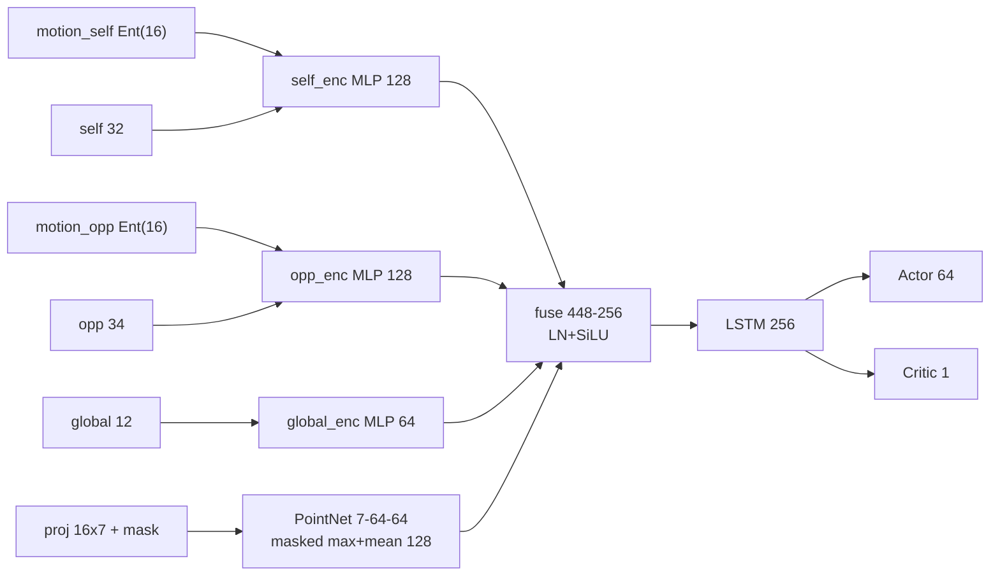

# Walkthrough — th155 强化学习接入(逆向 / 桥接 / Gym 环境)

本文记录 **Issue 01 ~ 06** 的实现与实机验证结果。目标游戏:`th155.exe` v1.21b
(32 位,PE TimeDateStamp `0x5ADDC646` / SHA256 `fc670809…8ee1f8`)。

> 环境:Windows 10 x64,Python 3.11,MSVC(32 位),IDA Pro 9.4(idalib)。

---

## 1. 交付物

| 文件 | 作用 |
|---|---|
| `configs/offsets.yaml` | 全部 RVA/指针链/版本校验 + 安全与危险路径标注 |
| `configs/env.yaml` | 观测归一化、动作频率、7 分项奖惩权重配置 |
| `docs/re_notes.md` | 每条偏移的验证方式、崩溃根因、IDA 工具链 |
| `src/bridge/protocol.h` | 共享内存协议(C++ 侧,v5) |
| `src/bridge/th155_rl_bridge.cpp` | 注入式 Bridge DLL:`InputMulti::Update` inline hook + 状态发布线程 |
| `src/bridge/shm.py` | 共享内存客户端(ctypes 镜像协议) |
| `src/bridge/inject.py` | 远程线程注入 |
| `src/th155/{game,mem,sq,pe,menu,ops,session}.py` | 只读/可写内存访问、菜单自动化、回合控制 |
| `src/env/{obs_builder,action_space,reward,th155_env}.py` | Gymnasium 环境与奖惩计算器 |
| `tests/test_*.py` | 96 个无头单元测试(环境、奖励、策略网络、课程晋级、评估报告) |
| `scripts/{e2e,verify_bridge,verify_offsets,verify_control,random_agent,dump_stack,repro_com}.py` | 验证/复现工具 |

---

## 2. 逆向结论(实机核对)

### 2.1 对象图

```
SQVM (RVA 0x4DACE4) +0x34 -> roottable
  battle(table): state/time/time_unit/count/round/winner/match_num/win/match_num
                 team[2] -> PlayerTeamData(instance)
                 PracticeRestart / RoundReset (closure)
  menu.title / menu.practice / menu.character_select
  input_all / input_talk (InputMulti)
PlayerTeamData: master/slave(Player instance), input(InputMulti),
                life/life_max/regain_life, sp/sp_max/sp_max2, mp, op, op_stop,
                spell_active/spell_use_count, slave_ban, combo_count, current
Player instance userpointer -> Manbow::Actor2D
  x,y=+0x0C/+0x10  vx,vy=+0x2C/+0x30  dir=+0x38  animation=+0x3C
  AnimationController: motion=+0x1C  keyFrame=+0x24
InputMulti: x,y=+0x04/+0x08  b0..b11=+0x0C..+0x38  last_device=+0xA4
            state_writer=+0xCC  vtable[1] = InputMulti::Update (RVA 0x6F360)
```

### 2.2 三条硬性约束(全部有 minidump 栈回溯佐证)

1. **`input.x` 是绝对屏幕方向**,不是相对朝向(脚本里用 `input.x * direction` 判前后)。
2. **全新启动的游戏 `input_all.last_device = -2`**,必须写 `-1`(键盘),否则
   角色选择界面无法创建输入设备,自动化进不了对战。
3. **练习模式在自动化下不稳定**:`player2=3` 3.5s 崩,`player2=0` 6s 崩(未注入 DLL 也复现);
   **对局中写 `com_difficulty/com_level/...`、写 `battle.time=0`、改 `endWinDemo`
   都会触发游戏自身的 `std::bad_function_call`(空 `std::function` 任务)崩溃或卡死**。
   → 训练统一走 **VS COM + 自然 KO 回合切换**,难度只在开局前经 `config.difficulty.vs` 设定。

### 2.3 崩溃定位方法

`scripts/dump_stack.py` 解析 Windows 自动生成的 minidump:
异常码 `0xC0000409`(`__fastfail(7)`),EBP 链
`abort <- __CxxThrowException <- sub_4C1280`,而 `sub_4C1280` 里是
`if (v5 == 0) std::_Xbad_function_call();`。
注意 IDA 地址换算:`ida_va = dump_va - 实际基址 + 0x400000`。

---

## 3. 桥接 DLL(协议 v5)

* `InputMulti::Update` 入口 5 字节 inline hook → 执行原函数后**在合并之后**写入
  `x/y/b0..b5`,因此不会被 `state_writer` 覆盖,逐帧精确。
* 后台线程每 2ms 解析脚本对象图并发布到共享内存 `Local\th155_rl_bridge_v1`:
  队伍资源、4 个角色原生状态、最多 512 个弹幕、控制块(Python→DLL)。
* 发布字段(v5 新增):`current`(前台角色)、`occult`(= `team.op`,0..2000)、
  `tag_ready`(`slave_ban==0 && op>=1000`)、`spell_ready`(`op>=2000 && sp>=sp_max2`)。
* 协议带 `magic + version`,版本不匹配客户端直接报错(避免静默错位)。

验证:`scripts/verify_bridge.py` 12 项全部 PASS(状态一致性、右移、攻击、回合、COM 难度)。

---

## 4. Gymnasium 环境

### 4.1 观测(`src/env/obs_builder.py`)

| 段 | 维度 | 内容 |
|---|---|---|
| `self` | 32 | 在场角色 one-hot(按 `team.current` 动态提取 master/slave 物理属性)、位置(按 `s` 定向)、前后版边距离、速度、轴线 one-hot、朝向、motion、动作帧、硬直、6 个状态标志、血量/白血、灵力、怪奇/换人、符卡 |
| `opp` | 34 | 同上 + `rel_dx`、`rel_dy` |
| `global` | 12 | 剩余时间、血量优势、回合、状态、上一步动作(方向/按键) |
| `proj` | 16×7 | 按距离排序的前 16 个弹幕(相对坐标/速度/判定半径/归属/可擦弹)+ `proj_mask` |

镜像不变性:`s = sign(x_opp - x_self)`,所有水平量乘 `s`。测试
`test_mirror_observation_identical` 对整帧做左右镜像后逐元素比对通过。

### 4.2 动作(`src/env/action_space.py`)

`Discrete(64)` = 9 相对方向 × 7 按键(None/A/B/C/D/Tag/Occult) + Spell。
写内存前按 `s` 还原成绝对 `input.x`;掩码规则与脚本一致(灵力/换人/怪奇/符卡)。

### 4.3 奖励与惩罚机制(`src/env/reward.py` / `configs/env.yaml`)

每步回报拆分为 **7 个可独立监控的分项**:
`r_t = r_hp + r_regain + r_resource + r_combat + r_approach + r_corner + r_terminal`:

| 分项键名 | 参数与默认值 | 奖励(Reward)与惩罚(Penalty)规则 |
|---|---|---|
| `hp` | `w_damage: 2.0` | **实血伤害与回复差**:打掉对手实血或自身后台白血转实血得正分(满管 `+2.0`);自身掉实血或对手回血扣负分(满管 `-2.0`)。 |
| `regain` | `w_regain: 0.5`<br/>`w_tag_recover: 0.05`<br/>`tag_recover_min_gap: 1000` | **白血上限差 + 凭依换人回血引导**:削减对手 `regain_life` 得正分,自身白血上限下降扣分(满额 `±0.5`);当自身待恢复白血 `regain - life >= 1000` 且触发换人(`current` 切换)时给予一次性引导奖励 `0.05 * (gap / 10000)`。 |
| `resource` | `w_guard_crush: 0.15` | **破防奖惩**:打碎对手防御(`sp_max` 下降)得 **`+0.15`**;自身被破防扣 **`-0.15`**。 |
| `combat` | `w_counter: 0.04`<br/>`w_guard_punish: 0.05`<br/>`w_combo: 0.01` (`cap: 10`) | **零和对称立回博弈(需产生实际实血伤害)**:<br/>1) **打康/差合确反**:对手上一帧处于出招/收招(`motion != 0` 且非受击/非防御),本帧被起手打进受击(`prev_hs==0 -> cur_hs>0`)得 **`+0.04`**,自身乱出招被打康扣 **`-0.04`**;<br/>2) **防后确反**:上一帧防御(`baria > 0`)后本帧立即反击起手命中非中立对手得 **`+0.05`**,进攻被防后遭确反扣 **`-0.05`**;<br/>3) **连段确认**:`combo_count >= 2` 每多接一击得 **`+0.01`**(上限 10 连击),被连段对称扣 **`-0.01`**。 |
| `approach` | `w_approach: 0.05`<br/>`far_distance: 0.5` | **远距接近连续势函数**:本步无实血变化且距离 `d > 0.5` 时,按 `0.05 * (over_prev - over_cur)` 给分(靠近加分、拉远等额扣分,往返闭合轨迹恒为 `0.0`,防碎步刷分)。 |
| `corner` | `w_corner: 0.002`<br/>`w_self_corner: 0.002` | **版边压制与防自困对称势函数**:把对手压入版边(`< 0.15`)得 **`+0.002`**,对手逃出对称扣 **`-0.002`**(防跨线刷分);自身退入版边罚 **`-0.002`**,脱困得 **`+0.002`**。 |
| `terminal` | `win: 1.0`, `lose: -1.0`<br/>`timeover_win: 0.5`<br/>`timeover_lose: -1.0`<br/>`draw: -0.2`<br/>`w_terminal_margin: 0.5` | **终局胜负 + 剩余血量差动态结算**:<br/>• **KO 胜**:`1.0 + 0.2*(time/8910) + 0.5*hp_self` (**`+1.0 ~ +1.7`**,防优势瞎浪换血);<br/>• **KO 负**:`-1.0 - 0.5*hp_opp` (**`-1.0 ~ -1.5`**,被满血剃光头重罚 `-1.5`,逆风刮血至残血减轻至 `-1.0`);<br/>• **超时胜/负**:在 `+0.5 / -1.0` 基础上叠加 `0.5*(hp_self - hp_opp)`(超时负与 KO 负同基线,堵死劣势拖时间);<br/>• **平局**:**`-0.2`**。 |

### 4.4 环境(`src/env/th155_env.py`)

* `step()` 写动作后**等共享内存 `frame` 前进 `action_repeat` 帧**,不靠 sleep;
  等待循环只读共享内存的 `frame`/`battle_state` 头部字段,不构造完整状态字典。
* `reset()` **优先尝试 1 帧重置**(`BridgeShm.request_fast_reset()`):DLL 把
  `battle.battleUpdate` 闭包槽临时换成 `battle.RoundReset`,借游戏自己的每帧调用
  完成重置,再下一帧还原原闭包。实测血量/计时器/站位/弹幕在 **~25ms(2 帧)** 内归位
  (自然 KO 要走 11 秒);失败时自动退回"等自然 KO"路径。
* 只有 `battle_state ∈ {32(回合结束), 64(KO 演出), 128(下一回合初始化)}` 才算 `terminated`;
  `2`(开场倒计时)/`4`(载入)仍在回合内,继续等待。
* `reset()` 调 `th155.session.ensure_fighting()`,自动处理「回合切换(约 11s)」与
  「回标题→重进 VS COM(约 10s)」,并且**必须等到 `state == 8`** 才返回
  (进入 VS COM 时 `ensure_battle` 在倒计时 `state 2` 就会返回,需补一次 `wait_next_round`)。
* 每回合开始把 `battle.win[0..1]` 清零(**必须用完整 tag**,见 4.6),让比赛永远
  打不满 2 胜,从而绕开**无法自动推进的胜负对话**(该场景注入任何输入都推不动)。

---

### 4.5 桥接发布频率(关键性能修复)

最初 `PublishState` 只能做到 **2 次/秒**,而游戏跑 60fps,环境每步要等 4 帧 →
单步 0.5s。逐层定位:

| 现象 | 定位手段 | 结论 |
|---|---|---|
| 发布 2Hz | 在共享内存加 `dbg_loop_count/dbg_pub_ms/dbg_resolve_ms` 计数 | 循环本身 386 次/秒、`PublishState` 耗时 0ms |
| 循环很快但几乎不发布 | 同上 + 代码走查 | 循环里的帧号判断用了 `inst_field_int(battle,"count")`(按实例成员表找),而 `battle` 是**表**不是实例 → 恒返回 0 → 只有 500ms 兜底发布 |
| 字段查找昂贵 | 单次 `table_slot` 要线性扫描成员表(每项 3~4 次 RPM) | 加 `(容器地址, 名字指针)` 字段槽缓存,`ResolveGraph` 时清空(寿命 ≤ 250ms) |
| 对象图解析昂贵 | `ResolveGraph` 遍历整条指针链 | 改为「失败 / 帧号 1.5s 不动 / 每 5s 兜底」才重解析 |
| 弹幕遍历昂贵 | 每个弹幕 ~2 次 RPM | 弹幕按 1/4 频率刷新(15Hz),核心状态仍 60Hz |

修复后实测:`pub/s = 60.0`、`frame = 60.0 fps`、随机智能体 **11.8 步/秒**(目标 15Hz)。

### 4.6 崩溃根因:写内存必须用**完整 tag**(`0x05000002`)

训练最初每局 KO 后游戏就 abort(`0xC0000409` = `__fastfail(7)`),
minidump 栈顶是 `__CxxThrowException(pThrowInfo = __TI1?AVException@Sqrat@@)`,
抛错点是 `sub_40B860` 里 `Sqrat::Exception("wrong number of parameters")`。

逐步排除(脚本 `scripts/repro_ko_crash.py`,每次 ~90s,自己进 VS COM 让 COM 打死 1P):

| 做法 | 结果 |
|---|---|
| 只注入输入,不写任何 `battle.*` | ✅ 连续 KO,稳定进第 2 回合 |
| 每步清零 `battle.win`(raw tag `0x2`) | ❌ KO 后 abort |
| 回合开始清零 `battle.win`(raw tag `0x2`) | ❌ KO 后 abort |
| **完整 tag `0x05000002`** 清零 `battle.win` | ✅ 连打 3 回合不崩 |

根因:**游戏里所有 int 槽存的都是完整 tag `0x05000002`**,而 Python 写路径用的是
raw `0x2`。Squirrel 的 `_type()` 会 `& 0x00FFFFFF`,所以**读起来完全正常、类型判断也通过**,
但对象的高位状态位被写坏,后续脚本执行到该对象时抛 `Sqrat::Exception` → 进程 abort。
更早的 `battle.match_num = 99` 崩溃也是同一个坑。

修复:`src/th155/ops.py: write_int_slot` 统一写 `TAG_INT = 0x05000002`
(`write_bool_slot` → `0x01000008`),Bridge DLL 的 `inst_set_int` 本来就用完整 tag。

### 4.7 策略网络与 PPO 训练管线(issue 05)

**网络结构**(`src/agents/ppo_agent.py`,约 78 万参数):



* 动作掩码:非法动作 logits 置 `-1e8`,fp32 下 softmax 概率**精确为 0**
  (测试断言 `probs[illegal].sum() == 0.0` 且采样 500 次从不落到非法动作)。
* 弹幕编码:被 mask 掉的点先填 `finfo.min` 再 max-pool,掩码变化不影响输出
  (测试把被 mask 的点改成 999.0,encode 输出完全一致)。
* LSTM:`done=True` 时 `init_hidden()` 清零(采样循环与测试都覆盖)。

**训练器**(`src/train/train_ppo.py`,`configs/train_ppo.yaml`):

| 组件 | 实现 |
|---|---|
| 采样 | 单环境实机 `n_steps=512`;每步记录 `h_in`(该步之前的 LSTM 隐状态) |
| 序列 | 按 `seq_len=32` 切段,每段用自己的 `h_in` 初始化 → 截断 BPTT |
| 优势 | GAE(γ=0.9985、λ=0.97),正确用 `done` 截断且最后一步用 `last_value` 自举 |
| 损失 | PPO clipped surrogate + value MSE + 熵正则,梯度裁剪 0.5 |
| 早停 | `approx_kl > 1.5 × target_kl` 时提前结束本次更新 |
| 日志 | TensorBoard:`rollout/return`、`rollout/win_rate`、`loss/*`、`perf/fps`、`perf/infer_ms` |
| Checkpoint | `checkpoints/ppo_XXXXXX.pt` + 按胜率保存 `best.pt`,`--resume` 续训 |

**踩过的坑**(全部已修,按发现顺序):

| # | 现象 | 根因 | 修复 |
|---|---|---|---|
| 1 | 2048 步统计出 184 局、胜率 100% | `collect()` 在 `done=True` 后没 reset,终止态里每帧都算"新一局" | done 后 reset + 清零 LSTM 隐状态 |
| 2 | `max_episode_steps` 永远触发不了 | `collect()` **开头无条件 reset** → 每 512 步重开回合,单局永远到不了 1800 步 | reset 只在 episode 边界;`obs`/`ep_state` 跨 update 透传 |
| 3 | 训练日志 75% 胜率,加载同一 checkpoint 实测评测 0% | 胜负只看"双方血量是否归零";被击飞/换人时血量会先归零再回填 | 优先用游戏自己的 `battle.winner`(1=team0 胜,2=team1 胜) |
| 4 | 训练中途卡死,游戏停在 `state=32` 不动 | 比赛打满 2 胜 → 胜负对话用按键/注入都推进不了 | `ensure_fighting()` 检测 `battle.win >= 2` 立即返回 False;训练器自动 kill+start+注入 并重试 |
| 5 | 角速度/版边奖励能刷分 | `corner` 逐帧累加或进出不对称(`+1.0/-0.5`)、`approach` 符号函数(`±0.0005`)会被来回跨线或碎步刷分 | 全部改为严格对称势函数差分 `Phi(s') - Phi(s)`,任何闭合轨迹得分为 `0.0` |
| 6 | 1 帧重置后回合永远不结束 | DLL 的 1 帧重置调用的是脚本 `RoundReset()`,它把 `enableTimeCount/enableTimeUp` 置 false;只有 `Round_Fight()` 才重新打开 → 计时器冻结在重置时写入的值,回合只能靠 KO 结束 | `env._apply_round_units()` 在 reset 后**重新武装**两个 bool 并连续 3 次确认稳定 |
| 7 | 胜负被误判成 lose(血还领先 7000) | `battle.winner` 回合开始后不清零,`state=8` 读到的是上一回合的残留 | 只有 `battle_state ∈ {32,64,128}` 时才信 `winner` |
| 8 | 以为 COM1 = `com_level: 1` | `com_level {0:0, 1:33, 2:66, 3:100}` 是"难度索引 → 内部等级"表,`com_level: 1` 实际是 **COM2** | 配置改成 `difficulty: 0`(游戏内 EASY/COM1),且只在**进对局前**由 `config.difficulty.vs` 决定 |

**回合时长**(重要,决定了 episode 的粒度):

* `battle.time` 满值 `8910`(`99 × time_unit`,`time_unit=90`),**每秒扣 60 单位**
  → 一个自然回合 ≈ **148.5s**(HUD 显示 90 秒是因为它按 `time / time_unit` 折算)。
* 计时器只在 `!is_time_stop && enableTimeCount && time >= 0` 时递减(`battle_vs_player.nut:211`),
  归零时 `enableTimeUp` 为真才触发 `Round_TimeUP()`(按剩余血量判胜)。
* 回合长度用 `env.round_seconds` 指定(HUD 秒数):`battle.time = round_seconds × time_unit`。
  当前配置 `round_seconds: 99` = 游戏原生 99(内部 8910 单位,墙钟约 148.5s)。
  也可以在 `env.round_units` 里直接写单位数(1800 = 30s),实测在 `state=8` 写安全;
  **不要与 `skip_demo` 同用**,组合会崩。
* `max_episode_steps` 必须略大于 `round_seconds × time_unit / (60 / action_repeat)`,
  否则回合还没结束就被截断 → 拿不到终局奖励(99s 回合 @30Hz ≈ 4455 步 → 配置 4700)。

**吞吐上限**:整个系统受游戏 60fps 硬上限约束,**1 秒训练 = 1 秒墙钟**。
决策频率只改变"每秒采样多少步",不改变"每秒推进多少游戏时间":

| `action_repeat` | 决策频率 | 实测 fps | 30s 回合的 episode 步数 |
|---|---|---|---|
| 4 | 15Hz | 14.9 | 450 |
| 2 | 30Hz | **29.8** | **900** |
| 1 | 60Hz | ~55 | ~1800 |

**运行方式**

```bash
# 无游戏冒烟(验证训练循环)
python -m src.train.train_ppo --updates 2 --steps 64 --offline

# 实机训练(游戏需已启动;脚本自己注入 + 进 VS COM)
python -m src.train.train_ppo --updates 400 --steps 512
tensorboard --logdir runs/th155_ppo

# 覆盖决策频率(不写死配置)
python -m src.train.train_ppo --updates 40 --steps 512 --action-repeat 1

# 只做确定性评估(加载 checkpoint,打印每局胜负/血量)
python -m src.train.train_ppo --eval 20 --resume checkpoints/best.pt
```

实机训练自带自愈:`reset()`/`collect()` 抛异常(比赛打满 2 胜、游戏崩溃)时,
自动 `taskkill` → 重新启动 → 注入 DLL → 重新进入 VS COM,最多重试 5 次。

**单步推理耗时**(验收要求 < 1.0ms):

| 路径 | 中位数 | 说明 |
|---|---|---|
| 纯模型前向 | **0.55ms** | `torch.inference_mode()` |
| numpy→tensor + 前向(含采样) | **0.59ms** | 与 `collect()` 完全一致 |
| 实机在线(游戏 60fps 并行) | 1.7 ~ 1.8ms | GIL/CPU 争用,非模型开销 |

## 5. 验证记录

```bash
# 无头测试(不需要游戏)
py -3.11 -m unittest discover -s tests -v    # 96 tests OK

# 冷启动全链路:启动 -> 注入 -> 进 VS COM -> 12 项校验
python scripts/e2e.py
#   [ok] 进入 vs_com 对战   [ok] DLL 注入
#   PASS reset / state_*(8) / inject_move / inject_attack / com_difficulty
#   [OK] 桥接 DLL 全部验证通过

# 只跑 12 项校验(游戏已在对战中)
python scripts/verify_bridge.py
#   [OK] 桥接 DLL 全部验证通过
#   注:inject_move 会在受击硬直(hit_state != 0)时跳过并重试,
#       因为 1P 站桩时 COM 会把它按在角落里连打。

# 随机智能体(带掩码)跑 10 个 Episode
python scripts/random_agent.py --episodes 10 --max-steps 400
#   [ok] 10 episodes, 3595 steps, 298.5s (12.0 steps/s)   mean return = -0.200
#   其中 2 个 Episode 以 KO 结束(state=64, terminated),reset() 自动接上下一回合

# 1 帧重置(回合中途)
python -c "from bridge.shm import BridgeShm; ...; shm.request_fast_reset()"
#   before life=[5378] time=8910 -> after life=[9999] time=8910,ack 25ms(2 帧)

# 崩溃根因对照实验(每次 ~90s,自己进 VS COM 让 COM 打死 1P)
python scripts/repro_ko_crash.py --mode plain     # 只注入输入 -> 稳定
python scripts/repro_ko_crash.py --mode win       # 清零 battle.win(完整 tag)-> 稳定
```

桥接发布性能(修复后实测,`dbg_*` 字段可从共享内存直接读):

| 指标 | 修复前 | 修复后 |
|---|---|---|
| `PublishState` 频率 | 2 次/秒 | **60 次/秒** |
| 随机智能体步速 | ~1.1 s/step | **12.0 ~ 14.8 step/s** |
| 循环次数 | — | 386 次/秒(2ms sleep) |

实测数值样例(1P 灵梦,VS COM NORMAL):`x=512 -> 627.5`(右移注入)、
`motion 0 -> 200 -> 1100`(攻击)、`life 9999`、`time 8910 -> 8878`、
`com_difficulty=1 / com_level=33`。

---

## 6. 已知限制 / 后续

| 限制 | 影响 | 后续 |
|---|---|---|
| KO 演出期间无法直接跳状态 | 回合**中途**重置是 1 帧,但 KO 演出仍走状态机 | 已验证:中途 `request_fast_reset()` 25ms 完成 |
| 练习模式不可用 | Stage 0 改用 VS COM EASY | 若需要站桩靶,可用 `cpuState=null` 停用 COM 决策再验证稳定性 |
| 胜负对话无法自动推进 | 已用「每回合清零 `battle.win`」规避 | 找到 talk 场景真正读取的输入源 |
| `can_graze` / `attack` 标志为启发式 | 观测精度略低 | 映射 motion 表后替换 |
| 弹幕按 15Hz 刷新(核心状态 60Hz) | 高速弹幕位置最多滞后 ~66ms | 弹幕数少时可恢复逐帧刷新 |
| 写内存必须用完整 tag `0x05000002` | 用 raw `0x2` 会破坏对象、延迟崩溃(见 4.6) | 已在 `ops.write_int_slot` 统一 |
