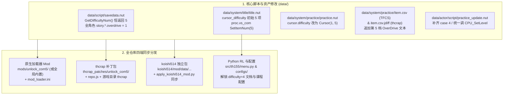

# 交接与实施计划文档：全 Mod 体系解锁 COM5 (OverDrive) 难度

> **创建时间**：2026-11-16  
> **目标范围**：《东方凭依华》（TH15.5 v1.21b）全部四个 Mod/训练子系统（原生 `mods/`、`thcrap_patches/`、`koishi514/`、Python RL `src/`）  
> **核心目标**：打通原版被菜单硬编码锁在 `0..3`（Easy~Lunatic）之外的隐藏第 5 难度 —— **COM5 / OverDrive (`difficulty = 4`)**，使故事模式、VS COM 对战模式、练习模式（Practice）以及 RL 训练/评估管线均能完整选择、显示并运行 COM5 (`com_difficulty = 4, com_level = 100, com_baria_rate = 90, com_guard_rate = 95`)。

---

## 1. 任务背景与逆向根因分析

### 1.1 引擎内 COM5 (`difficulty = 4`) 的真实存在性
通过对 `th155.pak` 反编译脚本（`.scratch/th155-rl-ai/decomp/src/`）的全面审计，TH15.5 底层已经完整实现了第 5 档难度（内部索引 `4`，即人类口径 **COM5** / **OverDrive**）：

1. **AI 核心参数表 (`data/actor/script/com_function.nut:158-192`)**：
   ```squirrel
   function CPU_SetLevel( diff_ ) {
       switch(diff_) {
       case 0: this.com_level = 0;   this.com_baria_rate = 0;  this.com_guard_rate = 25; break; // COM1 (Easy)
       case 1: this.com_level = 33;  this.com_baria_rate = 25; this.com_guard_rate = 33; break; // COM2 (Normal)
       case 2: this.com_level = 66;  this.com_baria_rate = 33; this.com_guard_rate = 50; break; // COM3 (Hard)
       case 3: this.com_level = 100; this.com_baria_rate = 66; this.com_guard_rate = 90; break; // COM4 (Lunatic)
       case 4: this.com_level = 100; this.com_baria_rate = 90; this.com_guard_rate = 95; break; // COM5 (OverDrive)
       }
   }
   ```
2. **标题画面精灵资源 (`data/system/title/title_animation.nut:91-99`)**：
   - `this.difficulty` 数组在初始化时**已经预加载了全部 5 个难度精灵**：`["easy", "normal", "hard", "lunatic", "overdrive"]`（位于 `data/system/title/title.pat` 与 `title_text.png`）。
   - 渲染循环按 `i >= this.action.cursor_difficulty.item_num` 截断显示数量，只要 `cursor_difficulty.item_num == 5`，标题菜单就会原生渲染出第 5 项 `OVERDRIVE` 图标与光标动画。

---

### 1.2 原版锁死 COM5 的四处门禁（Gating Points）

| 序号 | 所属模块 | 原始文件与行号 | 门禁原因与缺陷分析 |
|---|---|---|---|
| **G1** | 存档难度上限与故事模式 | [`data/script/savedata.nut:241-249`](file:///d:/programme/155rl/.scratch/th155-rl-ai/decomp/src/data/script/savedata.nut) | `GetDifficultyNum()` 仅在 `this.story.jyoon.ed & 255`（通关女苑篇）时返回 `5`，否则返回 `4`；且 `UpdateFlag()` 中各角色的 `story[v].overdrive` 依赖通关位 `ed & 16` 逐个解锁。 |
| **G2** | 标题画面 VS COM 菜单 | [`data/system/title/title.nut:14,164-169`](file:///d:/programme/155rl/.scratch/th155-rl-ai/decomp/src/data/system/title/title.nut) | 1. 第 14 行初始化 `this.cursor_difficulty <- this.Cursor(0, 4, ::input_all);`；<br>2. `this.proc.vs_com` 先执行 `this.cursor_difficulty.SetItemNum(4);`，随后执行普通赋值 `this.cursor_difficulty.val = ::config.difficulty.vs;`（无 `val >= num` 截断）。<br>3. **手工 UI vs 自动化内存写入区分**：<br>• **手工 UI 路径**：因 `item_num == 4`，`title_animation.nut:237` 隐藏第 5 项 `OVERDRIVE`，且方向键 `Cursor.Update()` 会将 `val` 取模/截断在 `0..3`，玩家无法手动点选 COM5；<br>• **RL 自动化路径**（`MenuDriver.enter_vs_com(4)`）：写 `::config.difficulty.vs = 4` 后，虽然 `proc.vs_com` 不会在赋值时截断 `val = 4`（且无方向键输入时 `UpdateButton()` 确认会直接把 `val = 4` 传给 `character_select.Initialize(0, 4)`），但 `title_animation.nut:297` 在 `state == 1` 分支会无条件访问 `this.difficulty[c]`（好在 `this.difficulty` 预建了 5 个元素 `0..4` 不会越界），不过一旦 `proc.vs_com` 被再次调用而 `val == 4` 时，`SetItemNum(4)`（`cursor.nut:207`）会先将旧 `val` 截断回 `3`，再被 `::config.difficulty.vs` 覆盖。通过将 `title.nut` 的 `SetItemNum` 改为 `5`，可同时彻底打通手工 UI 选择与自动化路径。 |
| **G3** | 练习模式菜单与文本表 | [`data/system/practice/practice.nut:120`](file:///d:/programme/155rl/.scratch/th155-rl-ai/decomp/src/data/system/practice/practice.nut)<br>`data/system/practice/item.csv` (Row 15) | 1. `cursor.difficulty <- this.Cursor(1, 4, ::input_all);` 将练习模式难度选择器上限硬编码为 `4`；<br>2. `item.csv` 第 15 行 `difficulty` 只有 `Easy / Normal / Hard / Lunatic` 4 组中日/英文本，缺少第 5 组 `OverDrive`，若仅改 `Cursor(1, 5)` 会导致 `UIItemSelectorSingle` 用 `"no text"` 占位（`ui_base.nut:499`）。 |
| **G4** | 练习模式实时更新 | [`data/actor/script/practice_update.nut:245-270`](file:///d:/programme/155rl/.scratch/th155-rl-ai/decomp/src/data/actor/script/practice_update.nut) | 1. 第 108-120 行分支（`player2 >= 3`）正确调用了 `this.CPU_SetLevel(::config.practice.difficulty)`；<br>2. 第 245-270 行冗余分支中 `switch(::config.practice.difficulty)` 只写了 `case 0..3`，漏写了 `case 4: this.com_level = 100;` 且未同步 `baria_rate / guard_rate`。 |

---

## 2. 跨子系统架构与实施计划



### 2.1 第一部分：核心游戏脚本与表文件修改清单

#### (1) `data/script/savedata.nut`
- **修改点 1**：`GetDifficultyNum()` 直接返回 `5`，无视 `this.story.jyoon.ed` 存档进度。
- **修改点 2**：在初始化循环与 `UpdateFlag()` 中，将 `story_list` 全部角色的 `t.overdrive <- 1` 设为默认解锁，使 Story Mode 选择 OverDrive 时全角色可用。

#### (2) `data/system/title/title.nut`
- **修改点 1**：第 14 行 `this.cursor_difficulty <- this.Cursor(0, 5, ::input_all);`（由 `4` 改为 `5`）。
- **修改点 2**：第 164-169 行 `this.proc.vs_com`：
  ```squirrel
  this.proc.vs_com <- function ()
  {
      local num = 5;
      this.cursor_difficulty.SetItemNum(num);
      this.cursor_difficulty.val = ::config.difficulty.vs;
      if (this.cursor_difficulty.val >= num)
      {
          this.cursor_difficulty.val = num - 1;
      }
      this.Update = this.UpdateDifficulty;
  };
  ```
  这样无论玩家手动在标题菜单选 VS COM，还是 Python 端 `MenuDriver.set_vs_difficulty(4)` 写入 `::config.difficulty.vs = 4` 后自动进入 VS COM，都能合法选中第 5 项（索引 `4`，即 COM5 / OverDrive），并将 `difficulty = 4` 传入 `::menu.character_select.Initialize(0, 4)` → `::vs.Initialize(param)` → `CreatePlayer(..., difficulty=4)` → `CPU_SetLevel(4)`。

#### (3) `data/system/practice/practice.nut`
- **修改点**：第 120 行：
  ```squirrel
  cursor.difficulty <- this.Cursor(1, 5, ::input_all);
  ```
  将练习模式暂停菜单第 3 页（COM 设置页）的 `difficulty` 光标项数从 `4` 扩展为 `5`（允许值 `0..4`）。

#### (4) `data/system/practice/item.csv` 与汉化补丁 `item.csv.jdiff`
- **原版 `data/system/practice/item.csv`（TFCS 压缩 CSV 格式）**：
  - 第 15 行原始列：`['difficulty', 'COM難易度', 'COM Difficulty', 'Easy', 'Easy', 'Normal', 'Normal', 'Hard', 'Hard', 'Lunatic', 'Lunatic', '', ...]`
  - `menu_common.nut::LoadItemTextArray` 按步长 2 读取 `1 + ::config.lang`（日文奇数列、英文偶数列），遇到空字符串 `""` 停止。
  - **修改方式**：将第 15 行第 11、12 列（索引 11、12）由 `'', ''` 改为 `'OverDrive', 'OverDrive'`，重新打包为标准 `TFCS` 二进制格式。
- **thcrap 简中补丁 `data/system/practice/item.csv.jdiff`**：
  - 在 `"15"` 节点下补充 `"11": "OverDrive"`：
    ```json
    "15": {
        "1": "COM难易度",
        "3": "Easy",
        "5": "Normal",
        "7": "Hard",
        "9": "Lunatic",
        "11": "OverDrive"
    }
    ```

#### (5) `data/actor/script/practice_update.nut`
- **修改点**：在第 251-269 行的 `case 3:` 中直接改为调用 `this.CPU_SetLevel(::config.practice.difficulty);` 并同步 `this.com_difficulty = ::config.practice.difficulty;`（同时补充 `case 4: this.com_level = 100; break;`），消除冗余分支不一致。

---

### 2.2 第二部分：在全部四个 Mod / 子系统中的落地方式

为了保证用户无论使用哪种方式启动游戏（直接双击 `th155.exe` 走 `winmm.dll` Mod Loader、通过 `thcrap_loader.exe` 启动、使用 `koishi514` 独立目录、或通过 Python RL 脚本启动），**整个 Mod 体系全部默认解锁 COM5**：

1. **`mods/`（原生 `winmm.dll` VFS Mod 加载器）**：
   - 新增独立模块化插件 `mods/unlock_com5/`（含 `mod.ini`，`Enabled=1, Priority=300`），内含上述 5 个修改后的明文 `.nut` 与 `TFCS` 格式 `item.csv`；
   - 同时在 `mods/mod_loader.ini`、`koishi514/release/mod_loader.ini` 及游戏安装目录 `D:/[th15.5] 东方凭依华（英文版+日文版）/mod_loader.ini` 中注册 `unlock_com5=1`。
   - **重要机制校验**：`manbow::CompileFile`（`0x424E40`）天然支持明文 `.nut`（非 `0xFAFA` 字节码时自动走 `sq_compilebuffer`），此前 `th135_lastwords`、`koishi_spells`、`th135_bg_mobs` 均已验证明文 `.nut` 直读完全正常；而 `manbow::LoadCSV` 读取 `TFCS` 二进制流，因此 `item.csv` 保持 `TFCS` 头部 + zlib 压缩即可。

2. **`thcrap_patches/`（thcrap 补丁仓库与游戏目录 `thcrap/`）**：
   - 新增 `thcrap_patches/unlock_com5/` 补丁包（或在现有合集中注册并启用），包含 `patch.js`、`th155/data/...` 下的 `.nut`、`item.csv` 与 `item.csv.jdiff`；
   - 更新 `thcrap_patches/repo.js` 与 `.scratch/deploy_thcrap_to_game.py`，并将补丁同步部署到 `D:/[th15.5] 东方凭依华（英文版+日文版）/thcrap/repos/th135_restoration/` 及 `config/th155_restoration.js`。

3. **`koishi514/`（全角色合集包与同步工具）**：
   - 将解锁 COM5 的 5 个数据文件放入 `koishi514/mod/data/`，使 `apply_koishi514_mod.py --sync-only` 自动将它们同步到 `koishi514/release/`、`mods/` 与游戏根目录。

4. **Python RL 框架 (`src/` & `configs/`)**：
   - `src/th155/menu.py`：更新 `set_vs_difficulty(index)` 注释与校验说明（支持 `0=EASY .. 4=OVERDRIVE(COM5)`，依赖 Mod 解锁 `title.nut` 的 5 项上限后，通过标题菜单进入 VS COM 可原生支持 `difficulty=4`）。
   - `configs/offsets.yaml`：更新 `vs_difficulty_table: "config.difficulty.vs"` 说明（原版 `0..3`，解锁 Mod 下 `0..4 -> EASY..OVERDRIVE(COM5)`）。
   - 新增或更新 RL 评估/训练配置（如 `configs/train_ppo_com5.yaml` 或课程配置），使 `--com-level 4`（对外 COM5）可通过标题菜单稳定进入对局。

---

## 3. 验证与回归测试计划

1. **静态与单元测试验证**：
   - 校验生成的 `data/system/practice/item.csv` 能够被 `TFCS` 解压解析器无损还原，且第 15 行包含 `OverDrive`。
   - 运行 `pytest tests/ -v` 确保 Python RL 侧课程与环境单元测试全部通过。
2. **实机游戏与内存验证（含前置基线实测）**：
   - **前置基线实测（Pre-check）**：在未挂载 `title.nut` 修改前，先对当前运行实例执行一次 `python scripts/verify_difficulty.py --via title --level 4 --keep`，验证原版 `proc.vs_com` 下直接写 `::config.difficulty.vs = 4` 能否在不改 `title.nut` 的情况下直通 `com_difficulty == 4`（区分纯 RL 内存路径与手工菜单 UI 路径的依赖边界）。
   - **Mod 挂载后全量验证**：启动带 Mod 的 `th155.exe`，进入标题画面 → `VS COM`，确认难度子菜单 `cursor_difficulty.item_num == 5`，画面显示第 5 项 **OVERDRIVE** 且可手动上下移动光标选中。
   - 使用 `MenuDriver.enter_vs_com(difficulty=4)`（或运行 `python scripts/verify_difficulty.py --via title --level 4 --keep`）进入 VS COM 对局，通过 `BridgeShm` / `Th155Game` 读取 2P 角色实例字段，验证：
     - `com_difficulty == 4`
     - `com_level == 100`
     - `com_baria_rate == 90`
     - `com_guard_rate == 95`
   - 进入练习模式（Practice），打开暂停菜单切到第 3 页，验证 `COM 难易度` 可切换到 `OverDrive` 且 2P 实时生效为 COM5。

---

## 4. 关键技术决策与风险防范 (Decisions & Risks)

1. **`title.nut` 中 `SetItemNum(5)` 对手工 UI 与 RL 自动化路径的精确作用边界**：
   - 经核查 `data/system/component/cursor.nut:81-133, 203-211` 与 `title.nut:164-169`：
     - `proc.vs_com` 的执行顺序是先 `this.cursor_difficulty.SetItemNum(4)`，后 `this.cursor_difficulty.val = ::config.difficulty.vs`（无 `if (val >= 4)` 截断），且 `Cursor.Update()` 在僅触发 `b0 == 1`（`UpdateButton()` 返回 `true`）时不执行 `item_num` 范围截断，同时 `title_animation.nut:91-119` 预分配了长度为 5 的 `this.difficulty` 数组（`0..4`），因此 `this.difficulty[4]` 不会越界。这意味着仅靠 `MenuDriver.set_vs_difficulty(4)` 在无方向键输入时已可穿透传入 `character_select.Initialize(0, 4)`。
     - 但在**手工菜单 UI** 下，`item_num == 4` 会导致第 5 个 `OVERDRIVE` 精灵被隐藏（`title_animation.nut:237`），且一旦玩家按上下方向键，`Cursor.Update()` 会立即执行 `(val + 4) % 4` 将光标锁死在 `0..3`。
     - 因此，在 VFS Mod 中将 `title.nut` 的 `cursor_difficulty` 改为 `5` 项，既能让玩家在游戏内标题画面直观看到并手动选择 `OVERDRIVE (COM5)`，也能消除 `SetItemNum(4)` 潜在的状态截断隐患。
2. **练习模式 `item.csv` 的格式陷阱**：
   - TH15.5 的 `.csv` 资产在 Pak 内并非明文 CSV，而是 `TFCS` 魔数头 + zlib 压缩的二进制行列流（Shift-JIS / CP932 编码）。如果直接放明文 `.csv`，`manbow.LoadCSV` 会解析失败返回空数组，导致练习菜单崩溃。因此必须使用专用打包脚本生成标准 `TFCS` 格式的 `item.csv`。
3. **明文 `.nut` 编码与语法规范**：
   - 所有替换的 `.nut` 脚本必须为无 BOM 的 UTF-8 / ASCII 纯净 Squirrel 源码，避免反编译器伪语法（如 `// Function is a generator` 等无效结构），但本次涉及的 `savedata.nut`、`title.nut`、`practice.nut`、`practice_update.nut` 均不含 generator，可直接编译。

---

## 5. 下一步接力执行步骤 (Next Steps for Handoff)

接力 Agent（或当前会话继续执行时）请按以下顺序执行：

1. **步骤 1（生成核心解锁文件）**：
   - 编写构建脚本 `.scratch/build_unlock_com5.py`，生成修改后的 `savedata.nut`、`title.nut`、`practice.nut`、`practice_update.nut` 以及重打包 `TFCS` 二进制格式的 `data/system/practice/item.csv`。
2. **步骤 2（部署至四端 Mod 目录）**：
   - 创建 `mods/unlock_com5/`（含 `mod.ini` 与 `mod/data/...`）并更新 `mods/mod_loader.ini`；
   - 创建 `thcrap_patches/unlock_com5/`（含 `patch.js`、`th155/data/...` 与 `item.csv.jdiff`）并更新 `thcrap_patches/repo.js`；
   - 同步至 `koishi514/mod/data/` 并执行 `python koishi514/apply_koishi514_mod.py --sync-only` 及 `python .scratch/deploy_thcrap_to_game.py`，确保游戏目录同步更新。
3. **步骤 3（更新 Python RL 侧支持与配置）**：
   - 更新 `src/th155/menu.py` 与 `configs/offsets.yaml` 中关于 `config.difficulty.vs` 取值范围 `0..4` 的说明；
   - 实机运行 `scripts/verify_difficulty.py --via title --level 4 --keep` 验证 COM5 (`com_difficulty=4, com_level=100, baria=90, guard=95`) 在对局中稳定生效。
